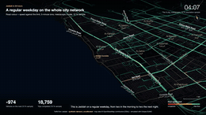
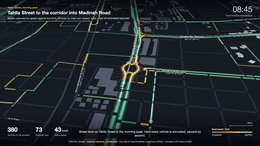
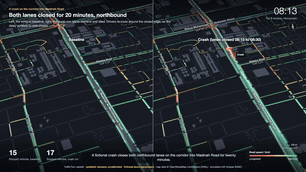
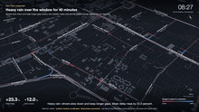
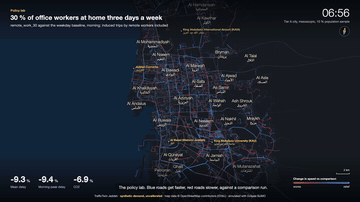
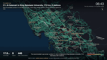

# TrafficTwin Jeddah

[](https://github.com/alturkestani/TrafficTwin/actions/workflows/ci.yml)
[](LICENSE)
[](pyproject.toml)
[](https://eclipse.dev/sumo/)
[](docs/assumptions.md)

**An open-source traffic digital twin of Jeddah.** TrafficTwin simulates a full 24-hour day for
the whole city on the real OpenStreetMap road network, with demand generated from a synthetic
population (people, households, jobs, schools, prayer times) rather than random trips. It answers
policy questions (remote work, staggered school hours, Friday and Ramadan days, bus lines, cordon
pricing, Loop tunnels) on a city-wide mesoscopic model (Tier A), injects events (crash, rain,
flood, motorcade, evacuation) into microscopic focus windows (Tier B), and ranks emergency response
plans that a human approves. Everything runs locally on a laptop with Eclipse SUMO, Python,
FastAPI and a React + deck.gl viewer, from public data only.

> All results use **synthetic demand, uncalibrated**: no real traffic counts exist for Jeddah in
> this project yet. Read them as comparisons between scenarios, not forecasts. Simulation and
> decision support only; it never actuates real infrastructure.



Project page: `site/` (published with GitHub Pages; preview in `docs/img/site.png`). Brief:
`PROJECT.md`. What is built and measured: `docs/STATUS.md`.

## 60-second quickstart

Needs macOS (Apple silicon) or Linux with [uv](https://docs.astral.sh/uv/), Node 22+ and npm,
`make` and `curl`.

```bash
git clone https://github.com/alturkestani/TrafficTwin.git && cd TrafficTwin
make demo CITY=0     # demo window only: setup + demo runs, viewer on http://localhost:5173
```

Then pick a run in the viewer's Run panel (events, strategist, evacuation, a policy comparison).
`make demo` without `CITY=0` adds the Jeddah city network (243 MB OpenStreetMap download) and a
one-hour city run: about 6.5 minutes from a clean clone. Details in [Quickstart](#quickstart-one-command).

## The films

Rendered from the simulation runs (edge bins, vehicle trajectories, event and strategist reports)
with headless deck.gl and ffmpeg; 1920x1080, 30 fps. The MP4s are not in git: they are attached
to the GitHub release, or rebuilt with `make movies` (needs the runs). Scenarios are fictional.

| film | what it shows | length | MP4 |
|---|---|---|---|
| `city-24h` | Tier A weekday baseline (network v2) as a 24 h time-lapse, camera from the Corniche to the whole city | 45.9 s | 93.2 MB |
| `tahlia-street` | Street level along Tahlia Street in the morning peak, vehicles coloured by speed | 30 s | 25.9 MB |
| `incident` | A crash on the corridor into Madinah Road, split screen against its baseline | 41.5 s | 40.4 MB |
| `events` | Heavy rain, a storm flood with closed flood sites, a motorcade | 40.1 s | 44.6 MB |
| `strategist` | An 08:30 ambulance: no strategy, then the top 3 ranked options with reasons | 47.1 s | 35.0 MB |
| `evacuation` | Obhur Creek mouth near the Jeddah Tower site: phased release with contraflow, clearance times (fictional) | 52.4 s | 34.6 MB |
| `policy-lab` | Remote work, staggered schools and a cordon in difference mode (network v2, v1 figures in the voice-over) | 50.9 s | 51.9 MB |
| `loop` | The recommended Loop tunnel C1 against the weekday baseline | 45.7 s | 93.7 MB |
| `obhur-bridge` | Bridges across Sharm Obhur: window runs (no saving beyond noise), then the city-scale v2 result card | 80.4 s | 35.9 MB |
| `showreel` | All nine as excerpts with title cards | 186.3 s | 195.5 MB |

GIF previews are in [Movies](#movies); how the films are made: `docs/movies.md`.

Two editions of every film: `movies/<film>.mp4` in English (voice Kokoro-82M, Apache-2.0) and
`movies/<film>.ar.mp4` in Arabic (voice Chatterbox Multilingual, MIT, cloning a ClArTTS reader,
CC-BY-4.0); both offline. Arabic edition: `make movies-ar`, see `docs/movies-arabic.md`.

## Results (headline numbers and their caveats)

Weekday, **10 % population sample**, seed 1, **synthetic demand, uncalibrated**. Policy deltas
are against the matching baseline on the same seed; run-to-run noise is about ±2 % on delay.

| what | result | source |
|---|---|---|
| City network (OSM, 2026-10-14) | 156,126 edges, 62,513 junctions, 20,953 lane-km | `docs/network-qa.md` |
| 24 h weekday baseline (Tier A, meso) | 389,289 vehicles; about 2 h uncached, peak about 3 GB RAM | `docs/population.md` |
| 30 % remote work | network v2: mean delay -11.4 %, AM-peak delay -13.2 %, VHT -8.7 %, CO2 -7.4 % (v1: -9.3 %, -9.4 %, -7.7 %, -6.9 %) | `docs/policies.md` |
| Schools staggered by 60 min | network v2: AM-peak delay -1.8 %, top-hour share -13 % (v1: -9.1 %, -19 %; matched control) | `docs/policies.md` |
| Ramadan weekday | +16 % vehicle trips, AM-peak delay -33 % | `docs/policies.md` |
| Central cordon charge | network v2: mean delay +30 %, VHT +17 % (v1: +20 %, +12 %; re-routing onto perimeter roads) | `docs/policies.md` |
| Crash on Tahlia (Tier B, micro) | window mean delay +5.7 % | `docs/events.md` |
| Emergency strategist | top 3 options in 11.6 s; best ambulance route 68 s vs 173 s with no strategy | `docs/strategist.md` |
| Evacuation, Obhur Creek mouth (fictional) | T50 / T90 / T100 = 933 / 1,702 / 2,115 s as written; strategist's balanced exits T90 1,402 s | `docs/evacuation.md` |
| Loop tunnel C1 (17.9 km) | about 63,000 vehicle-hours/day saved (two-seed mean, band 23k-103k), 28,820 passengers/day | `docs/loop.md` |

Caveats that matter:
- **Synthetic, uncalibrated.** Trip rates, start times and mode shares are documented assumptions
  (`docs/assumptions.md`); calibration (M8) is built but idle until real counts exist.
- **10 % sample.** The city runs use a 10 % population with capacity scaling; the full population
  was never run.
- **50.5 % teleports in the v1 network.** Half of the baseline's vehicles are teleported out of
  jams at least once, because most OSM roads lack lane counts and signals are sparse. Network
  capacity is the top realism gap; absolute delays are not meaningful, deltas are more robust.
- **Mesoscopic Tier A underestimates congestion** (`docs/fidelity.md`); one noise replicate per
  policy.

## Hardware

| use | needs | measured on |
|---|---|---|
| Demo window (`make demo CITY=0`, tests) | any recent laptop, 4 GB free RAM, 3 GB disk (1.3 GB of it Python and npm dependencies) | Apple M3 Pro, 18 GB |
| City network + one-hour city smoke (`make demo`) | about 3 GB RAM, 2 GB disk (243 MB extract, 353 MB network) | same |
| 24 h city baseline at 10 % (`make city`) | about 3 GB peak RAM, about 2 h uncached, 0.3-0.6 GB per run | same |
| Films (`make movies`) | ffmpeg, Google Chrome, about 1.5 GB browser RAM, 0.3 GB scratch per film | same |

Linux works (CI runs on ubuntu-latest; `docker compose up --build` is verified). Windows is untested.

## Project status

v0.1.0: milestones M0-M9 of `PROJECT.md` are done, plus Loop tunnels and the films; M8
calibration is built but dormant. Open work: the lane audit from imagery is **blocked** on
accuracy (60 % held-out precision against an 80 % gate), network capacity (teleports), larger
samples (25 %, 100 %), mode choice, induced demand, Friday and Ramadan films, and the viewer
comparison across network variants. Good first issues: [`docs/issues/`](docs/issues/).
Per-milestone status: `docs/STATUS.md`, `docs/status/`.

## Join in

TrafficTwin is one person's side project built in a week with AI coding agents, and it is at the
point where it needs other people more than more code. If any of these is yours, open an issue or a
pull request, or start a thread in Discussions:

- **Real counts for Jeddah.** The whole model is synthetic. Traffic counts, travel-time samples or an
  origin-destination survey (even a small, anonymised one) would switch on the calibration path
  (`docs/calibration.md`) and turn comparisons into forecasts.
- **Road inventory.** Lane counts and signal timings for the main corridors; the OpenStreetMap network
  still teleports 28 % of vehicles in the peaks (`docs/network-v2.md`), and most of that is missing
  capacity data, not code.
- **Transport modelling.** Activity chains, mode choice, induced demand, the evening peak, larger
  population samples; check the assumptions register (`docs/assumptions.md`) and argue with it.
- **Another city.** The pipeline is Jeddah-specific only in its polygon, zones and day types. Riyadh,
  Dammam, Makkah in Hajj season, or any city with a decent OpenStreetMap coverage is a fork away.
- **Arabic and English.** Documentation, the viewer's labels and the narrated films exist in both;
  a native-speaker pass on the Arabic narration scripts (`movies/specs/*.narration.ar.yaml`) is welcome.
- **Front-end and visualisation.** The deck.gl viewer, the cinema mode and the films.

Good first issues are in [`docs/issues/`](docs/issues/); the ground rules (determinism, tests on the
demo window, every assumption sourced) are in [`CONTRIBUTING.md`](CONTRIBUTING.md). Decision-support
only: nothing in this repository actuates real infrastructure, and nothing here should be used for
an emergency without a competent authority in the loop.

## Documentation

| topic | doc |
|---|---|
| Brief, scope, milestones | [`PROJECT.md`](PROJECT.md) |
| Status and measured numbers | [`docs/STATUS.md`](docs/STATUS.md), [`docs/status/`](docs/status/) |
| Architecture | [`docs/architecture.md`](docs/architecture.md) |
| 5-minute demo walkthrough | [`docs/demo-script.md`](docs/demo-script.md) |
| Assumptions register | [`docs/assumptions.md`](docs/assumptions.md) |
| Data sources and licences | [`docs/data-sources.md`](docs/data-sources.md), [`NOTICE`](NOTICE), [`docs/release-audit.md`](docs/release-audit.md) |
| Network and its QA | [`docs/network-qa.md`](docs/network-qa.md), [`docs/lane-audit.md`](docs/lane-audit.md) |
| Population and baseline | [`docs/population.md`](docs/population.md), [`docs/fidelity.md`](docs/fidelity.md) |
| Policies | [`docs/policies.md`](docs/policies.md) |
| Events and evacuation | [`docs/events.md`](docs/events.md), [`docs/evacuation.md`](docs/evacuation.md) |
| Strategist | [`docs/strategist.md`](docs/strategist.md) |
| Loop tunnels | [`docs/loop.md`](docs/loop.md) |
| Calibration | [`docs/calibration.md`](docs/calibration.md) |
| Viewer and API | [`docs/viewer.md`](docs/viewer.md), [`docs/contracts/run-outputs.md`](docs/contracts/run-outputs.md), [`api/README.md`](api/README.md) |
| Films | [`docs/movies.md`](docs/movies.md) |
| Contributing, conduct, security | [`CONTRIBUTING.md`](CONTRIBUTING.md), [`CODE_OF_CONDUCT.md`](CODE_OF_CONDUCT.md), [`SECURITY.md`](SECURITY.md) |
| Changes, citation, releasing | [`CHANGELOG.md`](CHANGELOG.md), [`CITATION.cff`](CITATION.cff), [`docs/release-checklist.md`](docs/release-checklist.md) |

## Quickstart (one command)

Needs macOS (Apple silicon) or Linux with [uv](https://docs.astral.sh/uv/), Node 22+ and npm,
`make`, `curl`, and network access. `osmium-tool` is installed with Homebrew when missing (Linux:
`apt install osmium-tool`).

```bash
git clone https://github.com/alturkestani/TrafficTwin.git && cd TrafficTwin
make demo            # opens http://localhost:5173 when ready; Ctrl-C stops the servers
```

`make demo` does, in order:
1. `make setup`: `uv python install 3.12`, `uv sync --frozen` (SUMO 1.28 from the `eclipse-sumo`
   wheel), `npm ci --include=dev` in `web/` (only when `package-lock.json` changed).
2. `make city-net`: downloads the Geofabrik GCC extract (243 MB, first run only), clips it to
   Jeddah and builds the v2 network `data/jeddah/jeddah.v2.net.xml` (about 2 min after the download). Skip with
   `make demo CITY=0` (no city view, no Tier A run).
3. `python -m sim.demo`: the demo runs (about 4 min; finished steps are skipped next time):
   a Tier B smoke and a fictional event scenario (accident under heavy rain, motorcade, ambulance)
   on the demo window, the emergency strategist, an evacuation, a demo-scale `remote_work_30`
   policy comparison, and a one-hour Tier A city smoke at 12:00. Run ids go to
   `runs/demo-manifest.json`.
4. `python -m api.ingest --all`, then `./run_app.sh`: API on :8000, viewer on :5173.

The viewer opens on the Tier A city run at mid-day; pick other runs in the Run panel. A
5-minute walkthrough is in `docs/demo-script.md`; the architecture in `docs/architecture.md`.

| command | what it does |
|---|---|
| `make demo` | everything above (`CITY=0` to skip the city; `DETACH=1` to leave servers in the background) |
| `./run_app.sh [--detach]` | serve whatever is in `runs/` (`TT_API_PORT`, `TT_WEB_PORT`, `TT_NO_OPEN=1`) |
| `make stop` | stop servers started with `--detach` |
| `make city` | network variant, zones and the **10 % weekday 24 h baseline** (long: about 2 h uncached, peak ~3 GB RAM; `SAMPLE=0.01` for a quick check) |
| `make test` | ruff, format check, pytest (demo window, about 3 min), web typecheck |
| `make screenshots` | headless Chrome screenshots `docs/img/final-*.png` of the running demo |
| `docker compose up --build` | the same demo in containers (a `demo` job, then `api` and `web`) |

Ports already in use? Set `TT_API_PORT=8010` (the viewer proxies to it) or stop the other server.
The Geofabrik extract is "latest", so a fresh clone builds from newer OSM data than the measured
numbers in `docs/STATUS.md` and its network hash differs; runs are deterministic for a given
network and seed.

## Setup by hand (macOS arm64 or Linux)

```bash
uv python install 3.12
uv sync                         # Python 3.12 venv; SUMO 1.28 comes from the eclipse-sumo wheel
brew install osmium-tool        # Linux: apt install osmium-tool
cd web && npm ci --include=dev  # viewer dependencies
```
SUMO binaries and tools are found through the `eclipse-sumo` wheel; `SUMO_HOME` is set
automatically by `sim/common.py` (or honoured if already set).

## Tests (demo window only, offline, about 3 min)

```bash
uv run ruff check . && uv run ruff format --check . && uv run pytest -q
```

## Build the Jeddah city network (M1, network v2)

```bash
# downloads the Geofabrik GCC extract (243 MB) on first run, clips it to data/osm/jeddah.poly,
# tags untagged major roads with the lane/speed medians measured on the clip, runs netconvert,
# applies data/osm/fixes/*.yaml and writes the GeoJSON side outputs (~2 min)
uv run python -m sim.network.build_city                        # profile v2 -> jeddah.v2.net.xml
uv run python -m sim.network.build_city --network-profile v1   # M1 settings -> jeddah.net.xml

# re-cut the committed demo window from the city network (same pipeline as Tier A)
uv run python -m sim.network.build_window --name demo --osm-extract
```
Outputs (gitignored): `data/jeddah/jeddah.v2.net.xml`, `data/jeddah/districts.geojson`,
`data/jeddah/buildings.geojson`, `data/jeddah/jeddah.v2.build.json` (provenance and network size),
`web/public/data/*.geojson` (viewer). Tier B windows (and the demo window) are cut from the v1
network. Profiles, evidence and measured effect (teleports 50.5 % -> 28.3 % in the 10 % weekday
baseline): `docs/network-v2.md`. Teleport hotspots of any run:
`uv run python -m sim.network.teleports hotspots runs/<run>/sumo.log --net data/jeddah/jeddah.v2.net.xml`.

Inspect the fix list against a built network:
```bash
uv run python -m sim.network.fixes check --net data/jeddah/jeddah.v2.net.xml
```

## Smoke runs

```bash
# Tier A: whole city, mesoscopic, one hour of random trips (run it in the background; ~9 min,
# most of it routing): prints edges, junctions, traffic lights, lane-km, vehicles, runtime,
# real-time factor and teleport share (must be < 0.5 %)
mkdir -p logs && nohup uv run python -m sim.runner --smoke --tier A --seed 1 > logs/smoke-A.log 2>&1 &
tail -f logs/smoke-A.log

# Tier B: demo window, microscopic (seconds)
uv run python -m sim.runner --smoke --tier B --seed 1
```
Each run writes `runs/<run_id>/` with `meta.json` (seed, config hash, network hash, population
hash, SUMO version, results), `stats.xml`, `tripinfo.xml`, `edgedata.xml` and `sumo.log`.

## Population and 24 h city baseline (M2)

```bash
# zones on the v2 network, then synthetic population (10 % sample), weekday activity chains, duaIterate assignment (cached by
# network/population/day type/seed), final 24 h meso run, KPIs and plots (~2 h uncached, ~15 min cached)
uv run python -m sim.population.zones
nohup uv run python -m sim.runner --baseline --daytype weekday --sample 0.10 --seed 1 --gzip > logs/baseline.log 2>&1 &
uv run python -m sim.fidelity --window demo --seed 1   # meso vs micro on a window (PROJECT.md 9.4)
```
`--routing-threads 8` speeds up assignment but makes routes reproducible from the cache only
(TA-013/TA-015). Method and measured numbers: `docs/population.md`, `docs/fidelity.md`.

## Policy lab (M4)

```bash
uv run python -m sim.runner --policy remote_work_30 --daytype weekday --sample 0.10 --seed 1
uv run python -m sim.policies.sweep --policy remote_work --param share=0.1:0.5:0.1 --sample 0.10
uv run python -m sim.validate sim/policies/*.yaml
```
Each policy run writes `runs/<policy>/policy_report.{json,md}` against the matching baseline.
Results, matched controls and noise checks: `docs/policies.md`.

## Viewer and API (M3)

```bash
uv run uvicorn api.main:app --port 8000                              # file-backed API over runs/
cd web && npm install --include=dev && npm run dev                   # http://localhost:5173
```
`./run_app.sh` starts both with the right proxy settings; `docker compose up --build` runs the
demo job and then both (API on 8000, viewer on 5173). Data contract:
`docs/contracts/run-outputs.md`; viewer guide: `docs/viewer.md`.

## Focus windows and events (M5)

```bash
# Tahlia window with service roads, Tier A exit times, cut routes + Webster signals, flow check
uv run python -m sim.link window --name tahlia
uv run python -m sim.link tier-a --routes runs/source-smoke-A/routes.rou.xml --seed 1
uv run python -m sim.link cut --window tahlia --tier-a runs/tierA-exit-<hash>/
uv run python -m sim.link check --window tahlia --tier-a runs/tierA-exit-<hash>/ --seed 1
# a scenario against the window baseline (same seed): runs/<id>/scenario_report.{json,md}
uv run python -m sim.runner --scenario accident_tahlia --window tahlia --seed 1
```
Create the source route set first: `uv run python -m sim.runner --smoke --tier A --seed 1`, then
`mkdir -p runs/source-smoke-A && cp runs/smoke-A-s1-*/routes.rou.xml runs/source-smoke-A/`. Demo
scenarios: `sim/scenarios/{accident,rain,flood,motorcade,emergency}_tahlia.yaml` (fictional).
Results and caveats: `docs/events.md`.

## Emergency strategist (M6)

```bash
uv run python -m strategist.run --scenario emergency_tahlia_0830 --window tahlia --seed 1
uv run python -m strategist.approve <recommendation_id> [--option 1] [--actor name] [--reject]
uv run python -m strategist.log verify      # hash-chained, append-only decision log
```
Pipeline, actions and measured runs: `docs/strategist.md`.

## Evacuation (M7)

```bash
uv run python -m sim.runner --scenario evac_demo --seed 1             # demo window, ~15 s
uv run python -m sim.runner --scenario evac_obhur --seed 1            # Obhur Creek mouth (obhur window)
uv run python -m strategist.evacuation run --scenario evac_obhur --seed 1
```
`sim.runner --scenario evac_*` dispatches to `sim.events.evacuation run`. Method and results:
`docs/evacuation.md`.

## Loop tunnels (Track D)

```bash
uv run python -m sim.loop.run loop_demo --demo          # demo policy on the demo window, ~10 s
uv run python -m sim.loop.site                          # candidate corridors + map
uv run python -m sim.loop.run loop_recommended          # recommended corridor C1, city 10 %, ~10 min
```
Siting, candidate ranking, the policy sweep and the recommendation (C1 Al-Salamah - King Abdulaziz
University, shuttle mode capped at measured capacity): `docs/loop.md`.
Car-vs-Loop mode choice (logit with capacity cap and queue, replaces the fixed shift share when a
policy sets `mode_choice:`): `uv run python -m sim.loop.evaluate --mode-choice sim/loop/config/mode_choice.yaml --demo`;
method and riders per candidate in `docs/loop-mode-choice.md`.

## Calibration (M8, dormant until counts exist)

```bash
uv run python -m sim.adapters.synthetic --net data/demo/demo.net.xml --out runs/synthetic-demo --seed 1
uv run python -m sim.calibrate --counts runs/synthetic-demo/counts.csv --net data/demo/demo.net.xml \
  --routes runs/synthetic-demo/candidates.rou.xml --sample 1.0 \
  --travel-times runs/synthetic-demo/traveltimes.csv --counts-source synthetic --before
```
Synthetic counts only exercise the pipeline. See `docs/calibration.md`.

## Movies

Short films rendered from the runs (edge bins, trajectories, event and strategist outputs), one
per simulation mode, plus a showreel, with an English voice-over (Kokoro-82M, open model, fully
offline), subtitles (`movies/<film>.srt`), street, district and landmark labels, a compass and a
scale bar. Needs ffmpeg and Google Chrome; output in `movies/`.

```bash
make voice-setup                    # once: offline TTS venv (.venv-tts)
make movies                         # all films + movies/showreel.mp4 (MOVIE_FLAGS=--no-voice: silent)
make movie FILM=tahlia-street       # one film; MOVIE_FLAGS="--4k --fps 60 --letterbox" optional
make movies-ar                      # Arabic edition: movies/<film>.ar.mp4 + showreel.ar.mp4 (make voice-setup-ar once)
```

| | |
|---|---|
|  |  |
| `city-24h`: the weekday baseline as a 24 h time-lapse | `tahlia-street`: street level, morning peak |
|  |  |
| `incident`: crash run against its baseline | `events`: rain, flood, motorcade |
|  |  |
| `strategist`: the top 3 ambulance options | `evacuation`: Obhur Creek, phased release with contraflow (fictional) |
|  |  |
| `policy-lab`: policies in difference mode | `loop`: the recommended Loop tunnel C1 against the baseline |

How it works, the narration scripts, the spec schema and the camera-path cookbook:
`docs/movies.md`.

## Lane audit from imagery (blocked)

`sim/network/lane_audit.py` is built but its calibration precision is below the gate, so no
imagery-derived lanes are applied; the default network is v2 (OSM-measured defaults, `docs/network-v2.md`).
See `docs/lane-audit.md`.

## Layout

`sim/` simulation (network, population, day types, policies, events, runner), `strategist/`
decision logic, `api/` + `web/` presentation, `docs/` status, assumptions and data sources,
`tests/` demo-window tests.

## Licence

Code: Apache-2.0 (`LICENSE`). Data derived from OpenStreetMap is (c) OpenStreetMap contributors,
ODbL; SUMO is EPL-2.0 (dependency, not vendored); GASTAT open data with attribution. See `NOTICE`.

Contributing: `CONTRIBUTING.md`. Changes: `CHANGELOG.md`. Cite: `CITATION.cff`.
