# Architecture

TrafficTwin Jeddah is three layers that only talk through files: `sim/` (simulation) writes run
directories under `runs/`, `strategist/` (decisions) reads saved simulation states and writes
recommendations and an append-only decision log, and `api/` + `web/` (presentation) read both.
Nothing in the presentation layer runs SUMO except the smoke-run job endpoint, and nothing ever
actuates real infrastructure. Everything is **synthetic demand, uncalibrated**.

## Components and data flow

```mermaid
flowchart LR
  subgraph inputs["Public inputs"]
    OSM["Geofabrik GCC extract<br/>(OSM, ODbL)"]
    POLY["data/osm/jeddah.poly<br/>+ data/osm/fixes/*.yaml"]
    CENSUS["GASTAT census totals,<br/>assumptions in YAML"]
    FLOOD["data/jeddah_flood_sites.yaml"]
  end

  subgraph sim["sim/ (simulation)"]
    NET["network/build_city<br/>osmium + netconvert + fixes"]
    WIN["network/build_window<br/>focus windows"]
    POP["population/<br/>zones, persons, activity chains,<br/>modes, trips"]
    DAY["daytypes/<br/>weekday, Friday, Ramadan, Umrah"]
    POL["policies/<br/>transforms, report, sweep"]
    LINK["link.py<br/>cutRoutes: Tier A to Tier B"]
    EVT["events/ + scenarios/<br/>accident, rain, flood,<br/>motorcade, emergency, evacuation"]
    RUN["runner.py<br/>Tier A meso / Tier B micro"]
    MET["metrics.py, fidelity.py"]
    CAL["calibrate.py + adapters/<br/>(dormant, M8)"]
  end

  subgraph strat["strategist/ (decisions)"]
    CAND["candidates<br/>k-shortest routes, preemption,<br/>rescue lane, closures, phasing"]
    EVAL["fork + evaluate<br/>loadState what-ifs in parallel"]
    RANK["rank + explain + classify"]
    LOG[("decision log<br/>SQLite, hash-chained")]
  end

  subgraph pres["api/ + web/ (presentation)"]
    API["FastAPI<br/>runs, bins, trajectories,<br/>reports, recommendations, jobs"]
    CACHE[("runs/_viewer-cache<br/>edge index, sparse bins,<br/>Parquet")]
    WEB["React + deck.gl + MapLibre<br/>time slider, compare, panels"]
  end

  RUNS[("runs/&lt;run_id&gt;/<br/>meta.json, edgedata, tripinfo,<br/>fcd, reports")]

  OSM --> NET
  POLY --> NET
  NET -->|jeddah.net.xml, districts,<br/>buildings| POP
  NET --> WIN
  CENSUS --> POP
  DAY --> POP
  POP -->|trips| RUN
  POL -->|transformed plans<br/>or network| RUN
  RUN -->|Tier A routes| LINK
  WIN --> LINK
  LINK -->|window demand| EVT
  FLOOD --> EVT
  EVT -->|TraCI during the run| RUN
  RUN --> MET
  MET --> RUNS
  CAL -.->|when counts exist| POP
  EVT -->|saved state| CAND
  CAND --> EVAL --> RANK
  RANK --> LOG
  RANK -->|recommendation.json| RUNS
  RUNS --> API
  LOG --> API
  API --> CACHE
  API -->|HTTP, /api proxy| WEB
  WEB -->|approve / reject| API
  API -->|append decision| LOG
```

## Two tiers

```mermaid
flowchart TB
  A["Tier A: all of Jeddah<br/>SUMO mesoscopic, 24 h<br/>synthetic population (10 % sample)"]
  B["Tier B: focus window, 3-25 km²<br/>SUMO microscopic, 1 s vehicles<br/>events through TraCI"]
  S["Strategist<br/>forks of a saved Tier B state"]
  A -->|cutRoutes.py: routes that touch the window,<br/>with entry times| B
  B -->|saveState| S
  A -->|edge bins every 5 min| V["Viewer: city heatmap,<br/>district choropleth"]
  B -->|FCD trajectories| V2["Viewer: vehicles"]
  S -->|ranked options + reasons| V3["Viewer: strategist panel<br/>(human approves)"]
```

Policies change the population or the network **before** a Tier A run; events act through TraCI
**during** a Tier B run. Micro-only SUMO features (sublane, bluelight, lane outputs, FCD) are
asserted out of Tier A at config load (`sim/config/runner.yaml`).

## Run directory contract

Every run writes `runs/<run_id>/meta.json` with the seed, config hash, network hash, population
hash and SUMO version, plus SUMO outputs (`edgedata`, `tripinfo`, `stats`, and `fcd` for Tier B) and
any reports (`policy_report.json`, `scenario_report.json`, `evacuation_report.json`; strategist
recommendations under `runs/strategist/`). The API reads producer files as they are and normalises
them reader-side (contract v1.1, `docs/contracts/run-outputs.md`); its derived cache under
`runs/_viewer-cache/` is always safe to delete.

## How `make demo` uses this

`make demo` = `make setup` (uv sync, npm ci) → `make city-net` (`sim.network.build_city`, skipped
with `CITY=0`) → `python -m sim.demo` (settings `sim/config/demo.yaml`; manifest
`runs/demo-manifest.json`) → `python -m api.ingest --all` → `./run_app.sh` (uvicorn on 8000, Vite on
5173). `docker compose up --build` runs the same steps in a `demo` container before starting the
`api` and `web` services.

| step | tier | what it produces |
|---|---|---|
| `tier-b` | B, micro | random-trip smoke on the demo window with trajectories |
| `events` | B, micro | `sim/scenarios/demo_events.yaml`: accident under heavy rain, motorcade, ambulance vs the window baseline |
| `strategist` | B, micro | `emergency_demo`: three ranked ambulance strategies vs no strategy, logged |
| `evacuation` | B, micro | `evac_demo`: 150 vehicles leaving a block, clearance times vs a reference run |
| `policy` | A, meso | `remote_work_30` on a demo-scale population of the demo window vs its own 24 h baseline |
| `tier-a` | A, meso | one-hour city smoke at 12:00 on `data/jeddah/jeddah.net.xml` (random trips) |

## Where things live

| concern | code | config | docs |
|---|---|---|---|
| network | `sim/network/` | `sim/network/config/`, `data/osm/fixes/` | `docs/network-qa.md`, `docs/lane-audit.md` |
| population and baseline | `sim/population/`, `sim/daytypes/` | `sim/population/config/`, `sim/daytypes/*.yaml` | `docs/population.md`, `docs/fidelity.md` |
| policies | `sim/policies/` | `sim/policies/*.yaml` | `docs/policies.md` |
| windows, events, scenarios | `sim/link.py`, `sim/events/`, `sim/scenarios/` | `sim/network/windows/`, `sim/scenarios/*.yaml` | `docs/events.md`, `docs/evacuation.md` |
| strategist | `strategist/` | `strategist/*.yaml`, `strategist/scenarios/` | `docs/strategist.md` |
| calibration | `sim/calibrate.py`, `sim/adapters/` | `sim/config/` | `docs/calibration.md` |
| API and viewer | `api/`, `web/` | env vars (`api/README.md`) | `docs/viewer.md`, `docs/contracts/run-outputs.md` |
| assumptions | every YAML with `source:` / `assumption:` | | `docs/assumptions.md` |
