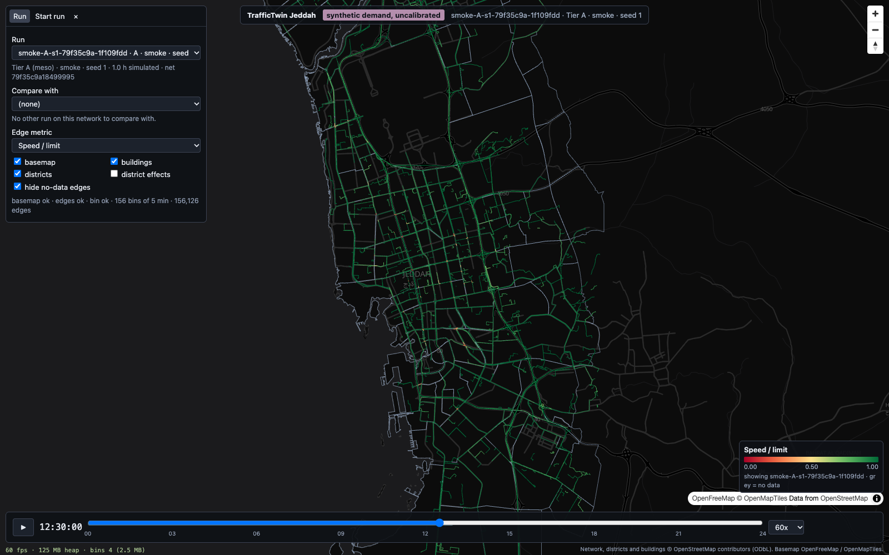
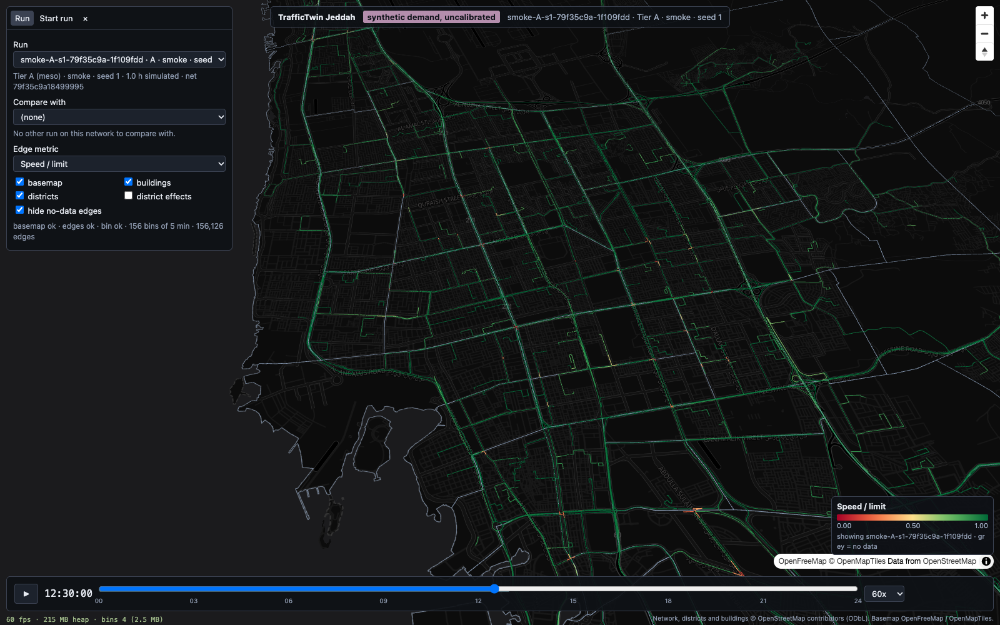
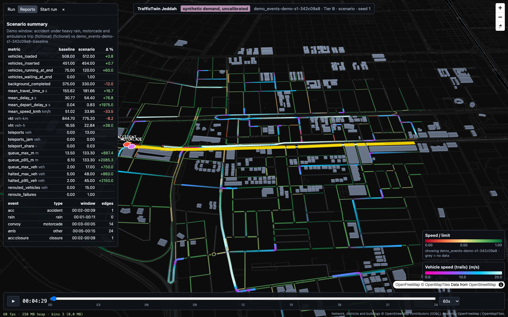
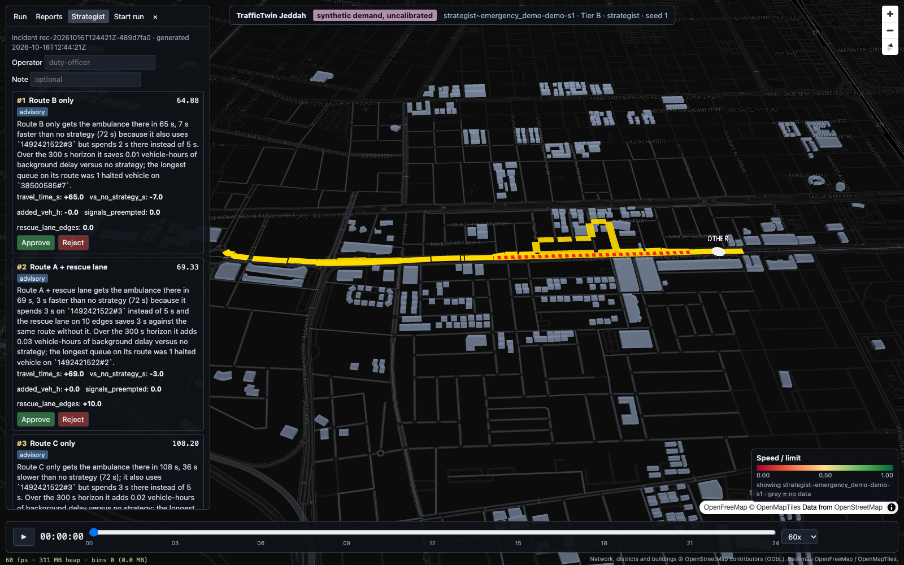
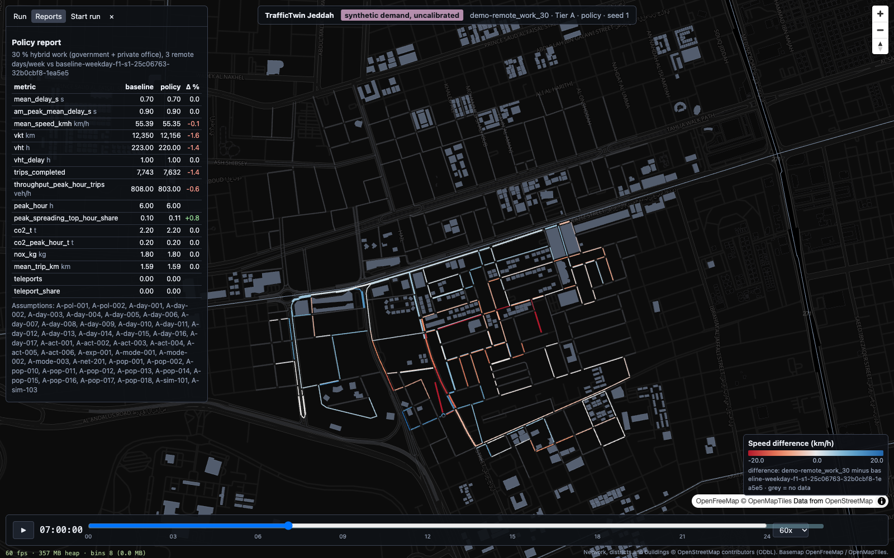

# Demo script: TrafficTwin Jeddah in 5 minutes

For a live walkthrough after `make demo` (see README). Every number on screen is **synthetic
demand, uncalibrated**, and every scenario is fictional (PROJECT.md section 11). Say so at the
start and point at the purple label in the top banner.

Run ids below are those of a clean clone on 2026-10-16 (seed 1); a clone built from a newer OSM
extract has a different city network hash in the Tier A run id. Screenshots:
`docs/img/final-*.png`.

## Before you start (once, about 6 minutes)

```bash
make demo                # or: make demo CITY=0 to skip the city (no Tier A views)
```
The browser opens http://localhost:5173 on the Tier A city run. Keep the terminal visible: it shows
that everything ran locally (SUMO 1.28 from the wheel, no cloud service).

## 0:00 - 0:45 The city (Tier A)



- "This is all of Jeddah as a SUMO network built from OpenStreetMap: 156,126 edges, 72 signals,
  112 districts. One command downloads the extract, clips it to the city polygon and applies a
  reviewed fix list."
- Run panel: run `smoke-A-...`, Tier A (meso), 1.0 h simulated. "Tier A is mesoscopic, so the
  whole city runs at about 250 times real time on a laptop."
- Edge colour = speed / limit, grey = no data.

## 0:45 - 1:30 Mid-day playback



- Drag the slider to 12:30 (the demo smoke runs 12:00-13:00), press play, set 60x.
- "The viewer streams 5-minute edge bins, not vehicles, so the city view stays light."
- Honest caveat: "This view is random test trips. The real 24 h weekday baseline from the
  synthetic population (389,289 vehicles at a 10 % sample) is `make city`; it takes about 2 hours,
  and its main open issue is network capacity (about half the vehicles teleport, TA-011)."

## 1:30 - 2:30 An event in a focus window (Tier B)



- Run panel: pick `demo_events-demo-s1-...` (Tier B, micro). The map flies to the demo window
  (Tahlia / Al Andalus, 3.3 km²).
- "Tier B is microscopic: individual vehicles at 1 s. This fictional scenario closes Tahlia
  Street eastbound for 7 minutes under heavy rain, runs a 4-car motorcade and an ambulance."
- Press play at 00:02; the accident marker appears and the queue builds behind it.
- Reports tab: mean delay 30.8 -> 54.4 s (+77 %), max queue 13.5 -> 133 m, 15 vehicles re-routed,
  against the window baseline with the same seed.

## 2:30 - 3:30 The strategist



- Run panel: pick `strategist~emergency_demo-demo-s1`; open the Strategist tab.
- "An ambulance has to pass a one-lane closure. The strategist forks the saved simulation state,
  tests candidate plans in parallel and ranks them: here three options in about 2 seconds."
- Read option 1 aloud: Route B, 65 s against 72 s with no strategy, with its plain-language
  reason. Point at the `advisory` / `approval required` badges.
- "The AI recommends; a person approves." Type a name in Operator and press Approve: the decision
  is appended to a hash-chained log (`uv run python -m strategist.log verify`). Nothing is
  actuated; this is simulation only.

## 3:30 - 4:30 A policy question



- Run panel: pick `demo-remote_work_30`; Compare with its baseline; mode `diff`; metric speed
  (km/h); slider at 07:00; Reports tab.
- "A policy is a YAML file that changes people's plans before the run: here 30 % of government and
  private-office workers on a hybrid scheme, with induced errands."
- "This demo runs it on a toy population of the demo window (8,000 residents) so it finishes in
  seconds: VKT -1.6 %, VHT -1.4 %. On the city at a 10 % sample the same policy gives mean delay
  -9.3 %, AM-peak delay -9.4 % and CO2 -6.9 % (docs/policies.md)."
- Blue edges are faster with the policy, red slower; every assumption id is listed under the
  table and in `docs/assumptions.md`.

## 4:30 - 5:00 Close

- Evacuation (optional, 20 s): pick `evac_demo-demo-s1-...`: 150 vehicles out in 733 s,
  90 % in 642 s.
- "Everything is open source, runs on a laptop, uses public data, and is labelled synthetic until
  it is calibrated against real counts. The calibration path is built and waits for data."
- Point to `docs/STATUS.md` for what is built, measured and blocked.

## If something goes wrong

| symptom | fix |
|---|---|
| `port 8000 is already in use` | `make stop`, or `TT_API_PORT=8010 ./run_app.sh` |
| viewer says "API not reachable" | check `logs/api.log`; restart with `./run_app.sh` |
| no Tier A run in the list | the city was skipped (`CITY=0`) or failed: `make city-net`, then `make demo` |
| a step failed half way | rerun `make demo`; finished steps are skipped (`runs/demo-manifest.json`) |
