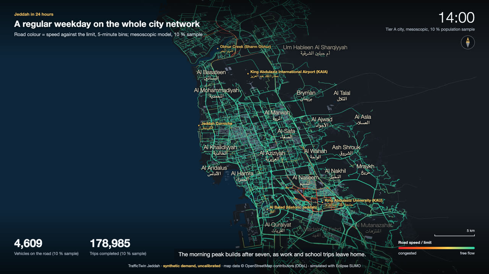
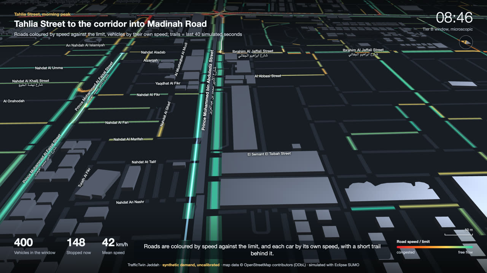
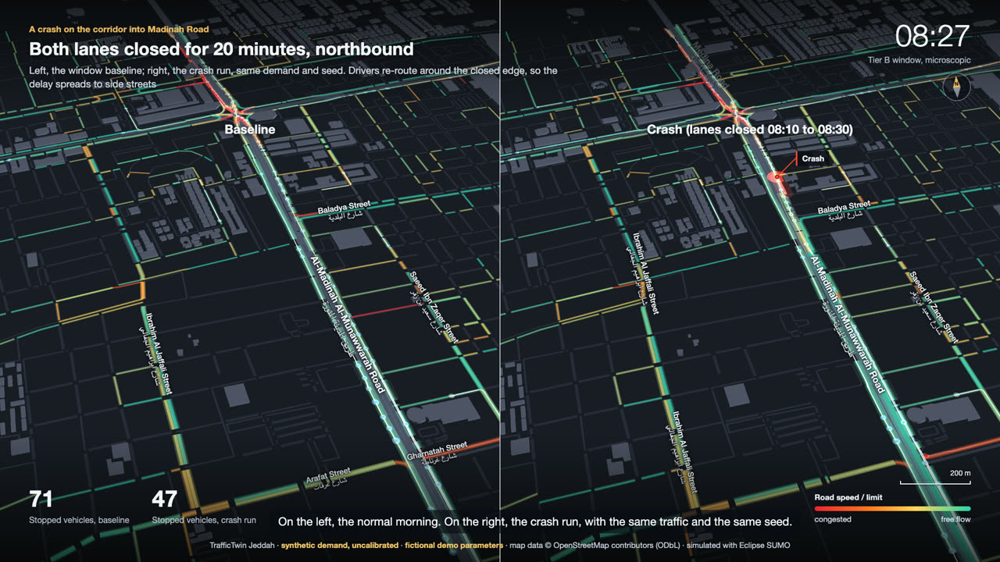
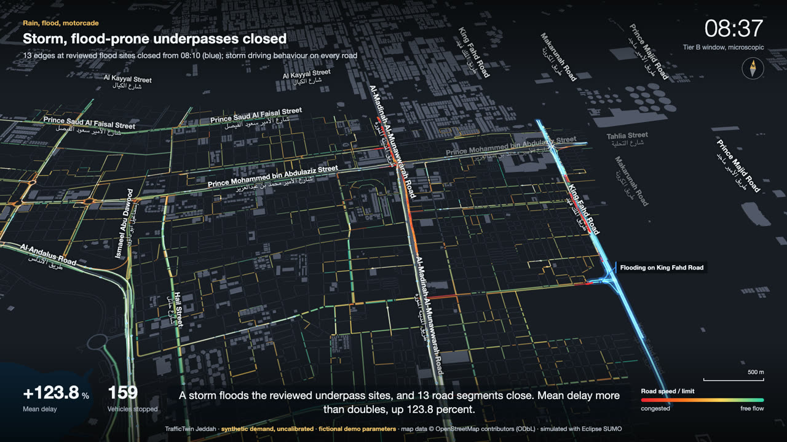
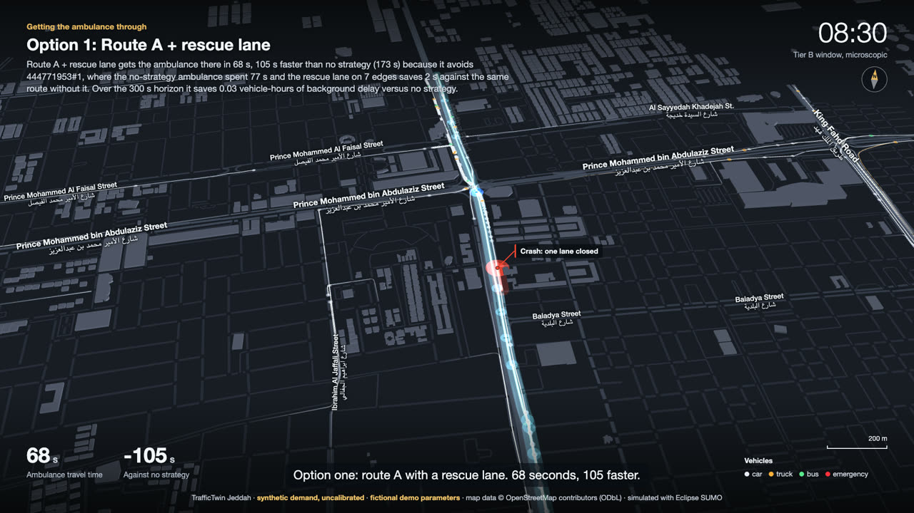
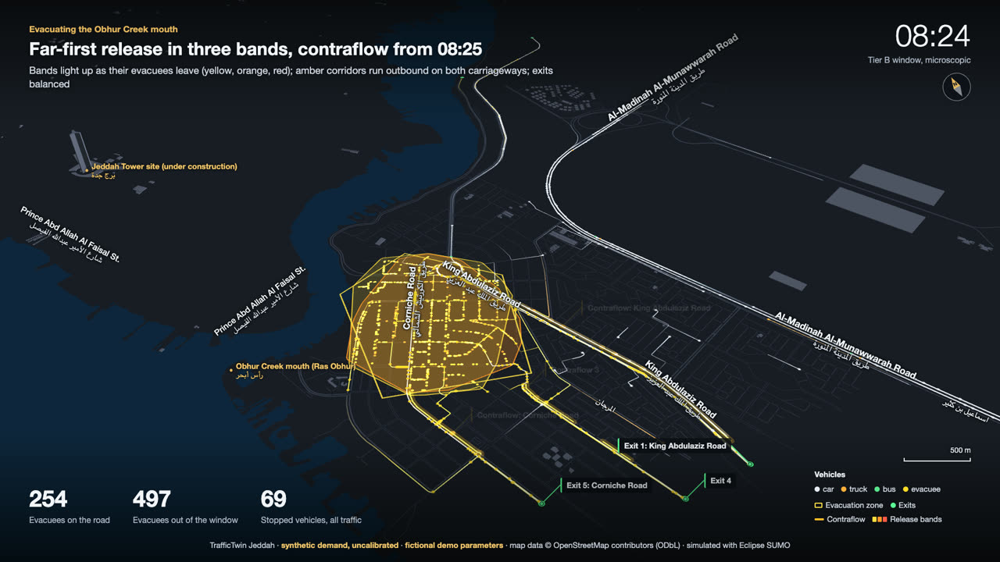
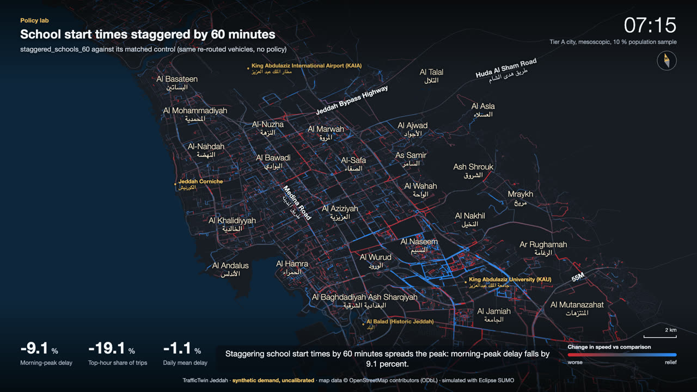
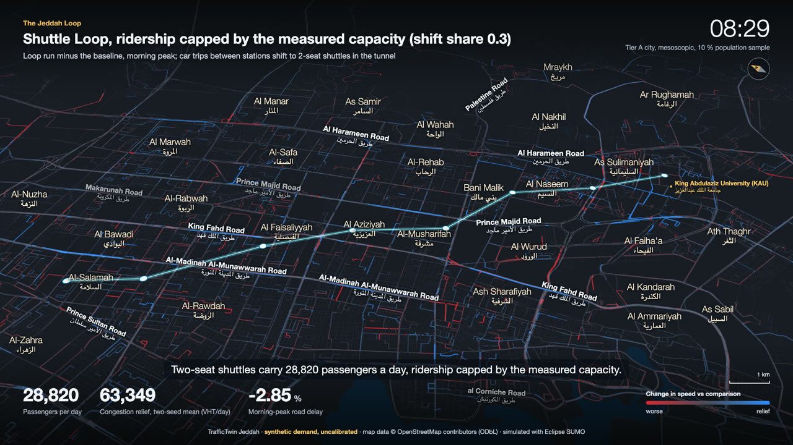
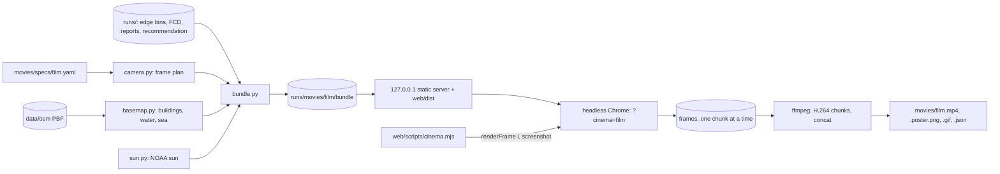

# Movies: cinematic films of the simulations

Track E turns existing runs into short films, one per simulation mode, plus a showreel. Every
frame is drawn from run outputs (edge bins, FCD trajectories, event and evacuation reports, the
strategist's recommendation); nothing is animated by hand. Every film carries the footer
**synthetic demand, uncalibrated** (plus **fictional demo parameters** on the scenario films).
Track I (MOVIES_V2) added an offline voice-over with subtitles, street, district and landmark
labels, a compass, a scale bar and event callouts, and moved the evacuation demo to Obhur Creek.

```bash
make voice-setup                     # once: offline TTS venv (.venv-tts, Kokoro-82M; downloads the weights)
make movies                          # every film in movies/specs/ + movies/showreel.mp4, with voice-over
make movie FILM=tahlia-street        # one film -> movies/tahlia-street.mp4 (+ .srt, .poster.png, .gif, .json)
make movie FILM=city-24h MOVIE_FLAGS="--4k --fps 60 --letterbox"
make movies MOVIE_FLAGS=--no-voice   # silent films with the specs' own timing (no TTS needed)
uv run python -m scripts.movies.narrate validate     # check every narration script
uv run python -m scripts.movies.narrate speak evacuation   # speak one film's lines, print the timing
uv run python -m scripts.movies.preview strategist   # http://127.0.0.1:8765/?cinema=strategist&play=1
uv run python -m scripts.movies.spec validate        # check every spec
```

Needs ffmpeg (`make movies-check` installs it with brew), Google Chrome (the same headless Chrome
the screenshot scripts use; `CHROME_PATH` overrides) and the runs named in the specs under `runs/`
(`TT_RUNS_DIR` overrides). Output goes to `movies/` (git-ignored except `movies/specs/`); bundles and
frames are cached in `runs/movies/` (`TT_MOVIES_DIR` overrides; the render smoke test uses a temp dir).

## The films

| film | what it shows | runs (all seed 1) | length |
|---|---|---|---|
| `city-24h` | Tier A weekday baseline as a 24 h time-lapse (02:00 to 02:00): edge speed/limit per 5-minute bin, camera pulls back from the Corniche to the whole city, sun rises and sets over Jeddah; the voice states the v2 teleport share (28.3 %, 50.5 % on v1) as a model-quality caveat | `baseline-weekday-f0.1-s1-ae764558-346893f2-a998e1` (network v2, 10 % sample, meso) | 45.87 s (narrated) |
| `tahlia-street` | Street level (pitch about 60 deg) dolly east along Tahlia Street, then north into the queue on the corridor to Madinah Road; trails, vehicles coloured by speed | `accident_tahlia-tahlia-s1-257eae8d~baseline` (window baseline) | 30 s (narrated) |
| `incident` | Split screen, window baseline against the crash run (both lanes of the northbound corridor closed 08:10 to 08:30), then the speed difference map; KPIs from the scenario report | `accident_tahlia-tahlia-s1-257eae8d` and its `~baseline` | 41.53 s (narrated) |
| `events` | One cut each: heavy rain (difference against the dry baseline), storm flood with the closed flood-site edges, a six-vehicle motorcade on Tahlia Street | `rain_tahlia-…-67ab9112` (+ `~baseline`), `flood_tahlia-…-48d26de0`, `motorcade_tahlia-…-060b80d4` | 40.13 s (narrated) |
| `strategist` | The 08:30 ambulance situation: no strategy, then the top 3 ranked options one after another, with the strategist's own reasons and ETAs on the HUD | `runs/strategist/rec-20261016T114454Z-22d13986` (emergency_tahlia_0830); cars around the ambulance from the window baseline | 47.10 s (narrated) |
| `evacuation` | Obhur Creek mouth evacuation (fictional), across the water from the Jeddah Tower site: far-first phased release (three bands lighting up), balanced exits and contraflow on three corridors; clearance times from the run; the HUD and voice say the strategist recommends balanced exits alone | `evac_obhur_film-obhur-s1-83e89905` (run for the film, see below) | 52.37 s (narrated) |
| `policy-lab` | Difference mode (blue = faster, red = slower): 30 % remote work against the baseline, staggered schools and the central cordon against their matched controls; KPI values from the docs/policies.md network-v2 rows, the voice gives the v1 figure in the same sentence | `v2-remote_work_30`, `v2-staggered_schools_60` (+ `--control`), `v2-cordon_center` (+ `--control`) (symlinks to `runs/v2/<policy>`), the v2 weekday baseline | 50.93 s (narrated) |
| `loop` | The recommended Loop tunnel from docs/loop.md: corridor C1 Al-Salamah - King Abdulaziz University (17.9 km, 8 stations, cyan line and stations) over the morning-peak baseline, then difference mode (Loop minus baseline) in the morning peak along the corridor and the evening peak across the city; KPIs from the docs/loop.md recommendation table | `loop_recommended` (shuttle, alpha 0.3, measured capacity; run for the film, see below) against `baseline-weekday-f0.1-s1-e5f1906a-65fac195-65b0f3` | 45.67 s (narrated) |
| `obhur-bridge` | Sharm Obhur bridges (Track J): the two crossings over the AM peak hour of the `obhur_creek` window, bridges against the matched control side by side, the window difference map, then a city-scale result card (B1 -170,801, B1 + B2 -178,909, B2 on top of B1 about -8,100 vehicle-hours/day on network v2) | window `obhur-am-s1-obhur_bridge_b3` and `obhur-am-s1-control`; card values from docs/obhur-bridge.md section 5 (`runs/v2/obhur_bridge_b1`, `runs/v2/obhur_bridge_b3`, + `--control`) | 80.37 s (narrated) |
| `showreel` | All nine films in order (order.yaml, then `obhur-bridge`), each after a title card, cut to the spec's `showreel: [start, end]` excerpt, joined with 0.6 s crossfades | the films above | 3 min 6 s, one spoken headline per film |

Stills (poster frames, from the middle of each film):

| | |
|---|---|
|  |  |
|  |  |
|  |  |
|  |  |

### Arabic edition (pass 8)

Every film also exists with an Arabic voice-over and Arabic subtitles, for Arabic-speaking
viewers: `movies/<film>.ar.mp4` (+ `.ar.srt`, `.ar.gif`, `.ar.json`, `.ar.poster.png`) and
`movies/showreel.ar.mp4`. Same frames and figures as the English films; the voice is Chatterbox
Multilingual (MIT) cloning a ClArTTS reader (CC-BY-4.0), offline. `make movie FILM=<film> LANG=ar`,
`make movies-ar`; scripts in `movies/specs/<film>.narration.ar.yaml`. Choice of the voice, the
checks, the scripts and what is not translated: [movies-arabic.md](movies-arabic.md).

| film | English `<film>.mp4` | Arabic `<film>.ar.mp4` | Arabic / English length |
|---|---|---|---|
| `city-24h` | 45.87 s, 93.2 MB | 55.13 s, 107.9 MB | x1.20 |
| `tahlia-street` | 30.00 s, 25.9 MB | 30.90 s, 26.5 MB | x1.03 |
| `incident` | 41.53 s, 40.4 MB | 48.90 s, 46.1 MB | x1.18 |
| `events` | 40.13 s, 44.6 MB | 47.17 s, 50.1 MB | x1.18 |
| `strategist` | 47.10 s, 35.0 MB | 54.77 s, 40.1 MB | x1.16 |
| `evacuation` | 52.37 s, 34.6 MB | 59.37 s, 37.5 MB | x1.13 |
| `policy-lab` | 50.93 s, 51.9 MB | 58.17 s, 57.0 MB | x1.14 |
| `loop` | 45.67 s, 93.7 MB | 53.53 s, 104.5 MB | x1.17 |
| `obhur-bridge` | 80.37 s, 35.9 MB | 89.20 s, 37.7 MB | x1.11 |
| `showreel` | 186.30 s, 195.5 MB | 186.33 s, 194.5 MB | x1.00 |

### What changed on network v2 (pass 7, 2026-10-17)

`city-24h`, `policy-lab` and `obhur-bridge` were re-rendered on main for the network-v2 runs of
integration pass 6, then the showreel (it embeds all three); the other six films are unchanged (their
narrated renders were taken from Track I). The v2 policy runs keep the bare policy ids under
`runs/v2/`, which collide with the v1 runs in `runs/`, so the API sees them through symlinks
`runs/v2-<policy> -> v2/<policy>` (the API is unchanged); the v2 baseline was already listed.
- `city-24h`: the v2 weekday baseline; the voice says once that 28.3 % of vehicles still teleport
  (50.5 % on the first network). 40.00 s -> 45.87 s (the caveat line stretches the time-lapse).
- `policy-lab`: v2 KPIs (remote work VHT -8.7 %, AM-peak -13.2 %; staggered schools AM-peak -1.8 %,
  top-hour share -13.3 %; cordon VHT +17.2 %, mean delay +29.7 %); each spoken number comes with its
  v1 figure ("on the first network it was ..."). 45.00 s -> 50.93 s.
- `obhur-bridge`: first narrated render on main; a fourth shot carries the city-scale v2 result
  card; the voice says the window showed no saving beyond noise while the city run gives -178,909
  VHT/day for B3 (9.2 %), with the 28-30 % teleport caveat. 80.37 s (the site shot's two lines
  stretch it x2.03, the 9 s result card x3.30).
- `showreel`: nine films (obhur-bridge joins after loop), 171.0 s -> 186.3 s; policy-lab headline
  = remote work -8.7 % vehicle-hours, obhur-bridge headline = window noise vs the 9.2 % city saving.
- Not refreshed: the README GIFs and stills in `docs/img/movies/` (`make movies-docs`) still show the
  v1 `city-24h` and `policy-lab` renders; regenerate them when the films are next published.

### What the films do and do not show

- **Incident.** `accident_tahlia` closes the whole edge, so affected drivers re-route (A-event-003).
  The run has no long queue at the crash: the extra delay (+5.6 s per vehicle, +5.7 %) shows up on
  the detours and later in the hour. The film shows that; it does not draw a shockwave the run
  does not contain.
- **Strategist.** The what-if runs record the ambulance's time on every route edge, not its
  trajectory. The film moves the ambulance along each edge over exactly that time (A-mov-008), so
  the ETAs on screen are the runs' own; the cars around it come from the window baseline (the
  what-ifs saved no FCD) and the crash marker is the closed lane of the snapshot.
- **Evacuation.** The public demo is the fictional `evac_obhur` (window `obhur`, Obhur Creek
  mouth near the Jeddah Tower site; the earlier waterfront demo in the tahlia window was withdrawn, TI-002). Its demo run
  is "as written" (simultaneous release, nearest exits). For the film, one window run was added
  with the strategist's fastest-clearance option `far_first_full` written into a copy of the
  scenario (`movies/specs/scenarios/evac_obhur_film.yaml`, same zone, crowd, timing and seed):
  `uv run python -m sim.events.evacuation run --scenario movies/specs/scenarios/evac_obhur_film.yaml --seed 1`
  (about 1.5 min; T50 815 s, T90 1,349 s, T100 1,746 s, identical to the strategist's what-if).
  The strategist recommends balanced exit guidance alone (T90 1,402 s, no approval needed); the
  last shot's caption and the voice-over say so (docs/evacuation.md). Release bands are drawn as
  hulls of where each band's evacuees start, lit from the band's first departure in the FCD.
- **Policy lab.** Edge colours are the policy run minus its comparison run, per 5-minute bin. The
  KPI numbers are copied from the docs/policies.md network-v2 rows (matched controls where the
  policy re-routes baseline vehicles, TA-018), never the raw unmatched deltas.
- **Obhur bridges.** The window shots are the Tier B AM-peak runs, where the bridges show no saving
  beyond noise. The last shot is a result card: its KPIs are the city-scale v2 numbers copied from
  docs/obhur-bridge.md section 5, drawn over the window difference map (the caption says so). The
  v2 city runs are not drawn as a map layer: the window network was cut from the first city
  network, and the film schema would only map v2 edges onto it by id (no new rendering code).
- **Loop.** Track D's city runs (`loop_opt_c1_a0p3` and the sweep) were pruned of their edge
  Parquet to save disk, so the film's run was produced on main with the recommended policy file:
  `uv run python -m sim.loop.run loop_recommended` (city 10 %, seed 1, about 10 min; same transform
  as `loop_opt_c1_a0p3`: 28,820 passengers/day, segment exceedance 0.017). The tunnel line joins the
  stations of `sim/policies/loop_recommended.yaml` straight, as the model's tunnel edges do (length
  = crow distance x 1.15). Shuttles run in the tunnel, not on the roads, so the coloured roads show
  only the surface effect. Relief, relief per USD M and the riders' figures are copied from the
  docs/loop.md Recommendation table (relief is the two-seed mean); the film does not recompute them.
  Near gridlock the difference map is noisy (docs/loop.md: one comparison is uncertain by about
  +/- 34,000 VHT/day), so isolated red and blue roads far from the corridor are noise, not effect.
- **Tier B clock.** Window runs start at t = 0; the HUD shows t = 0 as 08:00 (A-mov-007), as the
  strategist scenario does.

## Voice-over and subtitles

Each film has a narration script `movies/specs/<film>.narration.yaml` (the showreel has
`showreel.narration.yaml`): 4-8 plain-English lines, each tied to a shot by `at` (seconds into the
shot, a camera moment) or `sim_t` (when the shot's sim clock reaches it), saying what the viewer
sees and the measured number, and ending with the caveat. Every number spoken must already be in
docs/policies.md, docs/loop.md, docs/evacuation.md, docs/strategist.md, docs/events.md or this
file: `narrate validate` (and a test) reject any other number.

```yaml
film: evacuation
lines:
  - {shot: before, at: 0.6, text: "A fictional evacuation at the mouth of Obhur Creek ..."}
  - {shot: release, sim_t: 1500, text: "From eight twenty-five, three corridors run in contraflow ..."}
  - {shot: clearance, text: "All parameters are fictional. Synthetic demand, uncalibrated."}
```

- **Model.** Kokoro-82M (Apache-2.0, code and weights; https://huggingface.co/hexgrad/Kokoro-82M),
  kokoro 0.9.4 with misaki 0.9.4 and torch 2.14.1, model revision `f3ff3571`, voice **af_heart**
  (American English, calm documentary read) at speed 0.95 for every film (A-mov-009). It runs fully
  offline in its own pinned venv (`make voice-setup` -> `.venv-tts`,
  `scripts/movies/tts-requirements.txt`; the weights are fetched once into the Hugging Face cache,
  every later run sets `HF_HUB_OFFLINE=1`). No cloud TTS. Piper was the fallback; it was not needed.
- **Timing.** `scripts/movies/narrate.py` speaks each line to a WAV (cached per text, voice and
  versions in `runs/movies/_voice/`), measures it and places it at its anchor, never before the
  previous line has ended plus 0.45 s, the first after the title card (A-mov-010). If a shot's lines
  do not fit, the shot is slowed down: its duration and camera keyframes are stretched, the sim
  clock keeps its keyframes, so the time-lapse runs slower. Shots stretch to fit speech, never the
  reverse; the showreel excerpts follow the stretched films.
- **Audio.** The lines are mixed into one 24 kHz voice track of the film's exact length,
  loudness-normalised to -16 LUFS integrated and -1.5 dBTP (EBU R128, two-pass, linear,
  A-mov-011) and muxed as AAC 160 kbit/s 48 kHz with a soft English subtitle track (mov_text);
  `movies/<film>.srt` sits next to the MP4. The showreel speaks one headline per film over its title
  card (the films' own tracks are not cut) and ends with the caveat, so its script has one line
  per film plus the caveat (9 lines; the 4-8 rule is for the films). The README shows the films'
  GIFs; `make movies-docs` exports the showreel's still but not a showreel GIF (by design).
  Muxing trims the voice back to the film's exact length (loudnorm pads to 100 ms blocks), and
  stretched shots last a whole number of frames, so audio and video end on the same frame.
- **Subtitles** are drawn by the HUD from the same lines (Homebrew's ffmpeg has no libass or
  drawtext). `--no-subtitles` keeps the voice without them; `--no-voice` renders silent films with
  the specs' own timing.
- **Determinism.** Same script + model + settings => same audio: the TTS worker seeds torch before
  every line (Kokoro's vocoder draws noise), runs one thread with deterministic algorithms and
  PYTHONHASHSEED=0 (its G2P iterates over sets; without it two processes differed by up to 368
  LSB). The voice track's SHA-256 is recorded in `movies/<film>.json` (`audio.voice_sha256_16`).

## Map labels, compass, scale bar and callouts

- **Street names** come from the same OSM extract as the network (`scripts/movies/labels.py`,
  cached per map area in `runs/movies/_labels/`): `name:en` on the first line, the Arabic `name` as
  a smaller second line; ways named only in Arabic borrow the English name most often paired with
  the same Arabic name nearby, otherwise they are labelled in Arabic only (A-mov-012). Each named
  road gets anchors every 240-700 m (closer for minor roads) with the road's bearing. The renderer
  (`web/src/cinema/annotate.ts`) projects them per frame, rotates each label along the road (kept
  upright), and places them greedily by priority (landmarks, districts, then motorways, primaries,
  secondaries ...) with collision boxes that also avoid the HUD; streets appear by class as the
  camera comes down (A-mov-013), so only arterials label at city zoom. Labels are HTML, not deck.gl
  text: the browser shapes Arabic, deck.gl's TextLayer does not (TI-007). A label's opacity is the
  share of the last 8 frames in which it fits, so labels fade rather than pop and each frame is
  still a pure function of its index.
- **Districts** (admin_level=10 polygons, `data/jeddah/districts.geojson`) label at city zoom;
  **landmarks** (KAIA, KAU, Al Balad, Obhur Creek, the Jeddah Tower site, the Corniche) come from
  the reviewed `movies/landmarks.yaml` (OSM features, A-mov-014).
- **HUD**: a north arrow that turns with the camera bearing, a scale bar at the camera centre that
  follows the zoom, the colour legend (speed / difference / vehicle class, plus a key for the
  evacuation zone, exits, contraflow and release bands when they are on screen), the simulated
  clock and the footer (synthetic demand, uncalibrated; fictional demo parameters on the scenario
  films: `fictional: true` in the spec).
- **Callouts**: short leader-line labels at the crash, the flooded sites, the motorcade route, the
  evacuation exits and the contraflow corridors while they are active, with English street names
  where OSM has them (`callout` on the overlay items in the bundle).

## How it works



1. **Plan** (`scripts/movies/camera.py`). Frame i is at film time i / fps. Each frame gets its shot,
   camera (lon, lat, zoom, pitch, bearing) and simulated time from the shot's keyframes.
2. **Bundle** (`scripts/movies/bundle.py`). Everything the browser draws is precomputed into
   `runs/movies/<film>/bundle/`: road geometry (`roads.bin`), edge metric per 5-minute bin as
   uint8 (`heat-<source>.bin`, via the API's bin cache), vehicle paths for TripsLayer
   (`trips-<source>.bin`, from the FCD Parquet through the API's normaliser), overlays (events,
   closures, evacuation zone, exits, release bands, contraflow corridors, strategist routes),
   the basemap, and `frames.json` with, per frame: camera, sim time, sun light (NOAA position for
   Jeddah, A-mov-003), HUD clock, KPI values and fades. Runs are read only
   (`TT_RUNS_READONLY=1`; conversions go to `runs/_viewer-cache/`).
3. **Basemap** (`scripts/movies/basemap.py`). osmium cuts the camera's bounding box out of the
   Geofabrik PBF in `data/osm/`; buildings get `height`, else `building:levels` x 3.2 m, else 6 m
   (A-mov-001/002); the sea is built by polygonizing the coastline against the box (OSM coastlines
   keep land on the left) and continued past the box so pitched views show no edge. Cached per box
   in `runs/movies/_basemap/`. No tile server, no API key.
4. **Render** (`web/src/cinema/`, `?cinema=<film>`). A plain deck.gl `Deck` (no MapLibre, no React)
   with water, road base, edge heat with an additive glow, 3D buildings lit by a `LightingEffect`
   (ambient + a directional sun from the bundle), overlays, TripsLayer trails and vehicle heads
   (emergency vehicles pulse red/blue by frame index). The HUD is HTML: title card, caption and
   detail, clock, up to three KPIs counting up, legend, split labels, the footer. No wall-clock
   time and no randomness: `window.__cinema.renderFrame(i)` resolves after deck.gl has drawn
   frame i and the HUD shows it. The normal viewer is untouched (`main.tsx` only branches on
   `?cinema=`).
5. **Encode** (`scripts/movies/render.py`). `web/scripts/cinema.mjs` (puppeteer-core, as the
   screenshot scripts) steps frames into `runs/movies/<film>/frames/` in chunks of 150; each chunk
   is encoded with libx264 (CRF 18, yuv420p, bitexact flags) and its PNGs deleted, so at most one
   chunk is on disk; the chunks are joined without re-encoding. Then the poster (middle frame of
   the shot at the film's midpoint, clear of cuts), a GIF preview (palette, 10 fps, exactly 6 s, at most 3 MB) and `movies/<film>.json` (sizes, frame hashes,
   peak browser RSS, peak disk, timings, the GPU used).
6. **Showreel** (`scripts/movies/showreel.py`). Title cards are drawn with Pillow over the blurred
   poster (Homebrew's ffmpeg has no `drawtext`); each film is cut to its `showreel` excerpt; films and
   cards are joined with `xfade` crossfades. `make movies-docs` exports the README GIFs (10 fps, at
   most 360 px wide, narrower when needed to stay <= 1.2 MB) and JPEG stills to `docs/img/movies/`.

### Determinism

Same spec + same runs give the same bundle (`bundle/hashes.json`) and the same frames: the render
clock is the frame index, the bundle is fixed, layers are a pure function of (bundle, frame). Each
render records the SHA-256 of the first, middle and last frame free of any fade (no black or
half-black frames); the smoke test renders frames 100-110 of `tahlia-street` (past the title
card) twice at 640x360 and compares the three hashes. Frames are bit-identical on one machine and GPU; another GPU or Chrome
version can differ in the last bits of anti-aliasing (not verified).

## Spec schema

```yaml
film: tahlia-street          # = file name, [a-z0-9-]
title: Tahlia Street, morning peak
subtitle: Tier B microscopic window, every vehicle simulated at 1 s
duration_s: 30               # must equal the sum of the shot durations
date: 2026-10-18             # sun model date (default)
clock_t0: "08:00"            # local time of sim t = 0 (Tier B windows); omit for Tier A (t = seconds of day)
tier: B                      # A (city, meso) | B (window, micro): HUD tier line
fictional: false             # true: footer adds "fictional demo parameters" (scenario films)
annotations: {labels: true, compass: true, scale_bar: true}   # MOVIES_V2 map annotations
title_card_s: 2.5            # title card over the first seconds (0 = none)
showreel: [2.5, 24.5]        # excerpt used in the showreel
basemap: {bbox: null, margin_deg: 0.01, buildings: true, water: true, road_classes: all}
sources:                     # named data sources used by the shots
  base: {run: "accident_tahlia-tahlia-s1-257eae8d~baseline"}         # any run id the API lists
  r1: {strategist: rec-..., candidate: "A:reroute+rescue_lane", background: "<run id>"}
shots:
  - id: dolly
    duration_s: 30
    layers:
      heat: base             # edge colour source (speed / limit by default)
      compare: null          # with mode: diff -> heat minus compare (blue relief, red worse)
      mode: single           # single | diff | split
      split: null            # [left, right] sources (heat + vehicles per half)
      metric: speed_rel      # speed_rel | delay_s_per_veh | density_veh_km
      trips: base            # vehicle trajectories (Tier B)
      color_by: speed        # speed | class (car, truck, bus, emergency, convoy, evacuee)
      overlays: []           # events, closures, zone, exits, phases, contraflow, routes
      route_source: null     # strategist source whose route glows
      outline: null          # extra polygon, e.g. a policy cordon
      line: null             # extra open polyline [[lon, lat], ...], e.g. a Loop tunnel alignment
      stations: null         # points [[lon, lat], ...] drawn as station markers
      buildings: true
    camera:                  # keyframes; t = 0 first, strictly increasing
      - {t: 0,  lon: 39.148, lat: 21.549, zoom: 16.9, pitch: 58, bearing: 74, sim_t: 2700}
      - {t: 30, lon: 39.171, lat: 21.560, zoom: 17.5, pitch: 64, bearing: 340, sim_t: 2880, ease: in_out}
    hud:
      caption: Tahlia Street to the corridor into Madinah Road   # may use {source.fact:fmt}
      detail: Colour = vehicle speed; trails = last 40 simulated seconds
      legend: speed          # speed | diff | class | none
      split_labels: null     # [left, right]
      labels: {streets: true, districts: true, landmarks: true, callouts: true}   # per shot
      kpis:                  # up to 3; exactly one of value / series / fact
        - {label: Vehicles in the window, series: running, source: base}       # running | halted | arrived | mean_speed_kmh
        - {label: Mean delay, fact: delta.mean_delay_s.pct, source: crash, unit: "%", decimals: 1, sign: true}
        - {label: Mean delay, value: -9.3, unit: "%", decimals: 1, sign: true}  # literal, counts up over count_s
```

Facts are flattened from the run's normalised report: `summary.*` (scenario KPIs, e.g.
`mean_delay_s.delta_pct`), `delta.*`, `convoy.*`, `result.clearance.*` (evacuation), or for a
strategist source the candidate's result and option (`travel_time_s`, `vs_no_strategy_s`,
`label`, `rank`, `reason`, `title`). A missing fact fails the bundle; it is never filled in.

## Camera-path cookbook

Easing names the motion of the segment that ends at a keyframe (`linear`, `in`, `out`, `in_out`,
`hold`). Position moves in Web Mercator, zoom linearly, bearing along the shorter arc. The sim
clock is linear between keyframes that set `sim_t` and held outside them, so the time-lapse rate
is constant within a segment: rate = (sim_t1 - sim_t0) / (t1 - t0).

- **Fly-in**: zoom 11 -> 15.5 and pitch 20 -> 55 over 6-8 s, `ease: in_out`, a little bearing
  (10-20 deg) so the buildings turn.
- **Slow orbit**: keep lon/lat, change bearing by 40-90 deg over 15-20 s, `linear` or `in_out`;
  pitch 45-60.
- **Dolly along a corridor**: put each keyframe on the road's centreline (read it from the edge
  geometry, `api.edges` or the viewer), bearing = the road's direction (atan2 of east and north
  offsets), pitch 55-65, zoom 16.5-17.5. A 4-8x time-lapse keeps vehicles readable.
- **Pull-back reveal**: start at zoom 13.5-14 with pitch 55-60, end at zoom 10-10.5 (whole city at
  1080p) with pitch 30-35; long `in_out` segments.
- **Split screen**: `mode: split` draws the two sources side by side with the same camera; keep
  the subject in the middle of each half (zoom about 0.5 lower than a full-frame shot).
- Check a spec before rendering: `uv run python -m scripts.movies.preview <film>` and open
  `?cinema=<film>&play=1`, or render a few frames: `--frames 300:310 --keep-frames`.

## Adding a film

1. Make sure its runs are listed by the API (`uv run python -m api.ingest <run>` or just
   `GET /api/runs`). If a run is missing, produce it with its documented demo command, one SUMO
   run at a time (never a city baseline or the 25 %/100 % population).
2. Write `movies/specs/<film>.yaml` (schema above), add the name to `movies/specs/order.yaml`.
3. `uv run python -m scripts.movies.spec validate`, preview, then `make movie FILM=<film>`.
4. Register any new display assumption in `scripts/movies/settings.yaml` and
   `docs/assumptions-trackE.md` (`A-mov-NNN`).

## Performance (M3 Pro, 1920x1080, 30 fps)

Budgets: browser at most 2 GB RSS, at most 1 GB per film on disk during the render (bundle plus one
chunk of 150 PNG frames), no frames left behind. Measured on the narrated full render of 17 Oct 2026
(Track I, `make movies` with labels and voice-over; `evacuation` re-rendered after the Ras Obhur landmark was added, then the showreel; `movies/<film>.json`; hardware WebGL, ANGLE
Metal on the Apple M3 Pro; other agents were simulating in parallel). Durations are after the
narration stretch (the specs say 30-40 s). Voice = SHA-256 (16 hex) of the mixed voice track
before AAC; loudness = measured integrated loudness of the muxed AAC track (target -16 LUFS; the
-1.5 dBTP true-peak limit keeps a few films 0.4-0.9 LU below the target in linear mode).

| film | size | frames | duration | MP4 | GIF | per frame | total | browser RSS max | disk max | loudness | voice |
|---|---|---|---|---|---|---|---|---|---|---|---|
| `city-24h` | 1920x1080 | 1376 | 45.87 s | 93.2 MB | 2.59 MB | 0.17 s | 301 s | 1253 MB | 303 MB | -16.4 LUFS | `0ee7e479c3b0cd8e` |
| `tahlia-street` | 1920x1080 | 900 | 30.00 s | 25.9 MB | 2.93 MB | 0.14 s | 176 s | 1067 MB | 127 MB | -16.9 LUFS | `d6159532e3419a82` |
| `incident` | 1920x1080 | 1246 | 41.53 s | 40.4 MB | 2.23 MB | 0.16 s | 278 s | 1292 MB | 184 MB | -16.4 LUFS | `5a654a5099513955` |
| `events` | 1920x1080 | 1204 | 40.13 s | 44.6 MB | 2.94 MB | 0.15 s | 261 s | 1447 MB | 191 MB | -16.5 LUFS | `a317dfdc0af44f95` |
| `strategist` | 1920x1080 | 1413 | 47.10 s | 35.0 MB | 2.42 MB | 0.14 s | 278 s | 1286 MB | 152 MB | -16.6 LUFS | `83fefd7d0e152b21` |
| `evacuation` | 1920x1080 | 1571 | 52.37 s | 34.6 MB | 1.66 MB | 0.12 s | 262 s | 1496 MB | 120 MB | -16.6 LUFS | `bb102eabf0b202f9` |
| `policy-lab` | 1920x1080 | 1528 | 50.93 s | 51.9 MB | 1.78 MB | 0.18 s | 348 s | 1371 MB | 280 MB | -16.4 LUFS | `1357af6e18b0eae2` |
| `loop` | 1920x1080 | 1370 | 45.67 s | 93.7 MB | 2.19 MB | 0.25 s | 439 s | 1098 MB | 360 MB | -16.5 LUFS | `7c24d6f2b63268a6` |
| `obhur-bridge` | 1920x1080 | 2411 | 80.37 s | 35.9 MB | 1.17 MB | 0.12 s | 355 s | 1593 MB | 138 MB | -16.4 LUFS | `1866a93322328c0c` |
| `showreel` | 1920x1080 | 5589 | 186.3 s | 195.5 MB | 2.32 MB | - | - | - | - | -16.1 LUFS | `93a4fc76867803e3` |

"per frame" is draw + screenshot (labels add about 1 ms); "total" adds the narration (cached
after the first run), the bundle, chunk encoding, concat, the audio mux and the GIF. All eight
films render in about 39 minutes; the bundles take 1-10 s each (the first build of a
policy run's edge bins takes longer). `--4k` quadruples the pixels (not measured).

## Licences and credits

Map data © OpenStreetMap contributors (ODbL), simulated with Eclipse SUMO (EPL-2.0); rendering with
deck.gl (MIT), encoding with FFmpeg (LGPL/GPL, not bundled). The footer of every film carries the
OSM attribution and the synthetic label.
