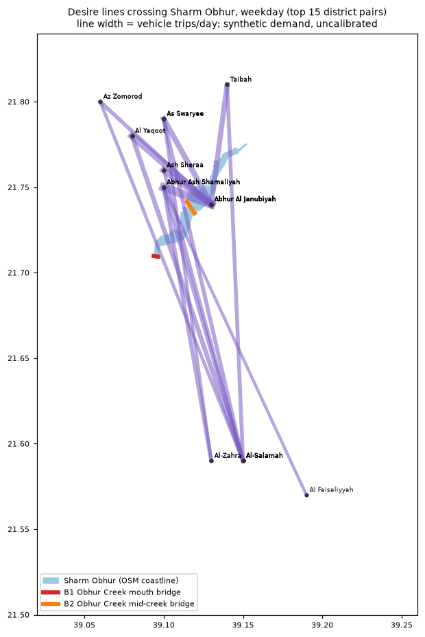

# Bridges across Sharm Obhur (Track J)

*All results: **synthetic demand, uncalibrated**.* Window results are Tier B (microscopic), one peak
hour, on the `obhur_creek` focus window; city results are **pending** the coordinator's Tier A runs
on the v2 network (commands below). Assumptions `A-obh-001..041` in `docs/assumptions-trackJ.md`,
sources in `docs/data-sources-trackJ.md`.

**The question.** Sharm Obhur (Obhur Creek) splits North and South Obhur. Today the creek is crossed
only at its head (the King Abdulaziz Rd / Madinah Rd junctions at its north-east end), so trips
between the banks drive round it. A bridge was planned (Metro Jeddah tender 2014-15, about US$1bn,
8 lanes plus metro; never awarded; the Jeddah Development Authority's Northern Obhur Road study
re-opened five alignments in 2021). What would one bridge, or two, change?

**Short answer.**
- **City screen (free flow, no simulation).** 238,130 car trips a day have a desire line across the
  creek. With B1 + B2, 145,370 of them get a shorter route, by **6.0 km** on average (2.9 min at
  free flow). The mouth bridge (B1) does almost all of it; B2 adds little on top.
- **Access limits use.** In today's network, three of the four landings are hard to reach from
  their own bank: a junction 1.1 km away is 8-24 km from the landing by road. B1's south end, on the
  King Abdulaziz Rd roundabout, is the exception. A real crossing would come with interchanges and
  local links that this network does not have.
- **Window (Tier B, one peak hour, matched control): no effect beyond the noise.**
  - The bridges carry traffic: in the morning peak hour B1 about 600 veh/h and B2 300-430 veh/h
    (both directions); in the evening under 110 veh/h each.
  - The time in the window per peak-hour vehicle changes by -16 to +53 s across variants and seeds,
    and the sign flips between seeds. The noise band (seed spread, and the control re-simulated on
    the bridge network) is about +/- 20 s. 3+3 lanes are no different from 2+2.
  - In the morning, bridge users gain nothing: queues build at the landing junctions (approach-road
    delay +31 % with B2). In the evening, the few users save about 7 min each.
- **The city run decides.** The window holds only the trips that touch the creek area, at 10
  copies per sampled vehicle, and its one-hour, one-shot routing cannot show a city-wide change of
  this size. The commands, runtime and the tables to fill are in section 5.

## 1. Today: the detour

Built from the weekday city baseline (`baseline-weekday-f0.1-s1-e5f1906a-65fac195-65b0f3`, 10 %
sample, `jeddah.m2.net.xml`), no simulation: `python -m sim.bridge.desire detour --baseline <run>`.
A trip crosses when the straight line from its origin to its destination edge crosses the inner
creek polygon (OSM coastline, `sim/bridge/config/sharm_obhur.geojson`, A-obh-007). Detours are
free-flow shortest paths on the passenger edge graph, today vs through each bridge (A-obh-030);
results in `sim/bridge/results/detour_summary.json` and `desire_lines.csv`.

| | trips/day across the creek | shortest route today (km, mean) | assigned route in the baseline (km) | baseline time loss (min/trip) |
|---|---|---|---|---|
| whole day | 238,130 | 30.7 | 35.6 | 106 |
| AM peak departures (06-09) | 36,660 | 31.8 | 39.0 | 144 |
| PM peak departures (16-19) | 49,830 | 31.5 | 35.4 | 125 |

These are 6 % of the 3.85 M car vehicle trips a day. The baseline's assigned routes are about 16 %
longer than the shortest paths (its meso run is congested: 50 % teleports, TA-011), so savings
are counted against the shortest path, the conservative choice. The baseline's time loss is that of
the congested city baseline, not of the creek alone.

What a bridge removes (free flow; a trip counts when its route is more than 0.5 km shorter):

| | trips/day shortened | km saved per shortened trip | min saved per shortened trip (free flow) | vehicle-km saved/day |
|---|---|---|---|---|
| B1 mouth | 144,070 | 6.0 | 2.9 | 864,851 |
| B2 mid-creek | 39,380 | 2.6 | 1.6 | 106,394 |
| B3 both | 145,370 | 6.0 | 2.9 | 869,825 |

Top district pairs (both directions, vehicle trips/day): Abhur Al Janubiyah - Abhur Ash Shamaliyah
5,430; Al Yaqoot - Abhur Al Janubiyah 4,420; Ash Sheraa - Abhur Al Janubiyah 4,130; As Swaryee -
Abhur Al Janubiyah 3,310; Taibah - Abhur Al Janubiyah 3,040; then long trips from the north-coast
districts to Al-Salamah and Al-Zahra (2,000-2,600 each), where B1 saves 6-7 km.



**Why B2 does so little: landing access.** `python -m sim.bridge.desire access --net
data/jeddah/jeddah.m2.net.xml` (`sim/bridge/results/landing_access.csv`) measures, for every
main-network junction 0.2-1.5 km from a landing on the same bank, the network distance to and from
the landing:

| landing | junctions | straight line (km, median) | to the landing (km) | from the landing (km) |
|---|---|---|---|---|
| B1 south (North Corniche Rd at the King Abdulaziz Rd roundabout) | 330 | 1.09 | 1.56 | 1.29 |
| B1 north (Prince Abdullah Al-Faisal St at the mouth) | 58 | 1.22 | 19.71 | 24.01 |
| B2 south (North Corniche Rd near King Abdulaziz Rd) | 207 | 1.10 | 10.45 | 8.07 |
| B2 north (Prince Abdullah Al-Faisal St, both carriageways) | 265 | 1.10 | 12.59 | 12.89 |

Prince Abdullah Al-Faisal St is a divided road with few connections to the residential grid on
its landward side along the creek, and the North Corniche is one-way at B2's south landing, so
local traffic reaches the B2 landings only by long loops. B1 works because its south end sits on the
King Abdulaziz Rd roundabout and its north end feeds Prince Abdullah Al-Faisal St northbound, the
route of the long north-south coastal trips. Whether this is the real street pattern or missing OSM
links should be checked on the v2 network (re-run the `access` command there).

## 2. Candidate crossings

| | B1 mouth | B2 mid-creek |
|---|---|---|
| south landing | North Corniche Rd junction west of the King Abdulaziz Rd roundabout (39.10018 E, 21.70910 N), Obhur Al Janubiyah | North Corniche Rd near King Abdulaziz Rd (39.11982 E, 21.73441 N) |
| north landing | Prince Abdullah Al-Faisal St at the mouth (39.08792 E, 21.71039 N), toward the Jeddah Tower / Jeddah Economic City site | both carriageways of Prince Abdullah Al-Faisal St (39.11184 E, 21.74551 N and 39.11197 E, 21.74546 N) |
| structure, junction to junction | 1.28 km | 1.47 km |
| over water (abutments on the OSM shoreline) | 281 m (the mouth neck) | 890 m |
| lanes | 2+2 (`obhur_bridge_b1`), 3+3 (`_3x3`) | 2+2 (`obhur_bridge_b2`), 3+3 (`_3x3`) |
| speed | 80 km/h span, 60 km/h approaches | same |
| public source | none places a crossing at the mouth: analysis alignment (A-obh-001) | follows the only published route description (Al-Eqtisad, Sep 2020: Madinah Rd, King Abdulaziz Rd, Obhur Corniche, the creek, Prince Abdullah Al-Faisal Rd); exact site unpublished (A-obh-002) |
| navigation | the only passage from the creek's marinas to the sea: needs navigable clearance or an opening span | crosses open creek between the marinas: same |

B3 = B1 + B2 (`obhur_bridge_b3`, `obhur_bridge_b3_3x3`). The published tender scheme had 4+4 lanes
plus two metro tracks over a crossing of about 350-380 m (2 km structure); 2+2 and 3+3 are the
brief's variants.

**Navigable span (flagged, not modelled).** Sharm Obhur holds marinas (Red Sea Marina, 300 berths
for yachts up to 60 m; Jeddah Yachts Marina). No clearance requirement for an Obhur bridge was found;
the "51 m" in the tender reports is the arch crown. A fixed bridge would need roughly 18-20 m over
a 75 m channel (Dubai Islands bridge 2025: 18.5 m), which sets the approach ramps (costed below); a
bascule would cost 1.4-1.6 times as much and close the road at each opening, which would need an
event model in the simulation.

## 3. How it is modelled

- **Policies** (`sim/policies/obhur_bridge_*.yaml`) are `network_change` transforms with a
  `bridges:` block (`sim/bridge/schema.py`): per crossing, an abutment per bank and `connect` points
  snapped to arterial junctions (trunk to tertiary, within 150 m, A-obh-010/011).
- **Network** (`sim/bridge/network.py`): one netconvert patch on the base network adds two
  abutment nodes, the span each way and an approach each way to every landing junction, in the
  network's own UTM projection, plus lane connections from every edge into a landing junction
  (A-obh-013; netconvert keeps the loaded connections otherwise). The variant is written under a new
  name (`data/jeddah/<base>.bridge-<key>.net.xml.gz`); the base network is never touched.
  Checks: every new edge joins the main strongly connected component, and duarouter routes landing
  to landing over the span in both directions. All six policies pass on the city network:
  `python -m sim.bridge.run <policy> --validate` (about 1 min, 1.7 GB each).
- **City run**: `python -m sim.bridge.run <policy>` runs Track A's `run_policy` with a dispatcher that
  builds the bridges (Track D's pattern). Vehicles whose baseline route touches the `obhur_creek`
  window, or whose O-D line crosses the creek, get a one-shot route on the baseline's congested
  times (45,443 of 389,289 sampled vehicles, 11.7 %); the matched control re-routes the same
  vehicles without the bridge (TA-018), and the report compares with that control. Demand is fixed:
  no induced trips, no mode or time shift (A-obh-006).
- **Window run** (`sim/bridge/window.py`, `obhur_creek`: the creek buffered by 500 m plus B1's
  mouth landings, the head interchange and today's north-to-south route round the head; 24.5 km2 of
  which 19 km2 land, 2,466 edges; 9 % of the cut cross-creek vehicles still leave and re-enter it): every city-baseline vehicle whose route touches the
  window gets entry times from the baseline's congested edge times (capped at 4 x free flow,
  A-obh-022), cutRoutes cuts it, and each sampled vehicle is replicated 10 times with +/- 150 s
  jitter (A-obh-021): 48,640 vehicles for the AM run (05:30-07:00 departures), 43,720 for the PM.
  Runs: `baseline` (the cut routes), `control` (every vehicle re-routed one-shot on the baseline's
  15-min congested times, A-obh-024) and one run per policy (same trips and weights on the policy's
  window variant). KPIs cover every vehicle due to depart in the peak hour, including those still
  queuing to enter or still driving at the end (time in system = arrival or the end, minus the
  planned departure).

## 4. Window results (Tier B, one peak hour)

`python -m sim.bridge.window report` (`sim/bridge/results/window_kpis.csv`). Δ = policy minus the
matched control, same seed. "Per vehicle" is the mean over the vehicles due to depart in the hour:
33,242 AM and 28,790 PM, including those still queuing to enter or still driving at the end.
Bridge volume = both directions of the span, veh/h.

**AM peak hour (06:00-07:00)**: 58 % of the peak-hour vehicles finish in the baseline, 62 % in the
control.

| variant | Δ time in window per vehicle, s (seed 1 / seed 2) | Δ vehicle-hours (seed 1 / 2) | bridge veh/h (B1 / B2) | bridge users | Δ time per user, min | Δ time loss, non-users, s | approach delay, veh-h (control 422) |
|---|---|---|---|---|---|---|---|
| B1 2+2 | -12.4 / +5.3 | -114 / +49 | 603 / - | 1,084 | +2.0 | -21.0 | 390 |
| B1 3+3 | +0.3 | +2 | 645 / - | 1,083 | +1.8 | -18.2 | 398 |
| B2 2+2 | -15.7 / +52.9 | -145 / +489 | - / 297 | 1,354 | -0.5 | -25.6 | 553 |
| B2 3+3 | +3.6 | +34 | - / 349 | 1,354 | -0.3 | -19.1 | 552 |
| B3 2+2 | +10.1 / -8.1 | +94 / -75 | 558 / 427 | 2,715 | +0.1 | +4.9 | 478 |
| B3 3+3 | -8.3 | -77 | 536 / 362 | 2,715 | 0.0 | -1.0 | 450 |

**PM peak hour (18:00-19:00)**: 82 % of the peak-hour vehicles finish.

| variant | Δ time in window per vehicle, s (seed 1 / seed 2) | Δ vehicle-hours (seed 1 / 2) | bridge veh/h (B1 / B2) | bridge users | Δ time per user, min |
|---|---|---|---|---|---|
| B1 2+2 | -6.2 / +5.3 | -49 / +42 | 76 / - | 68 | -6.5 |
| B1 3+3 | -6.9 | -55 | 76 / - | 68 | -6.9 |
| B2 2+2 | -11.9 / +5.5 | -95 / +44 | - / 99 | 99 | -7.1 |
| B2 3+3 | -4.5 | -36 | - / 99 | 99 | -6.5 |
| B3 2+2 | -5.7 / +11.1 | -46 / +89 | 40 / 79 | 109 | -6.8 |
| B3 3+3 | +0.1 | +1 | 40 / 79 | 109 | -7.1 |

**Noise band.** These are the deltas a no-change comparison gives:
- the control between seeds: -2.9 s (AM) and -8.9 s (PM) per vehicle;
- the control's routes re-simulated on the B3 network (bridge present, nobody routed over it):
  +17.0 s (AM).

Every variant's Δ lies within about +/- 20 s, apart from B2 2+2 AM seed 2 (+53 s), and the sign
flips between seeds for all three 2+2 variants in both peaks. At window scale none of the bridges
has a time effect distinguishable from noise.

**Routing gain.** The control is 68 s *faster* than the cut-route baseline per AM vehicle (+9 s in
the PM): re-routing every vehicle on the window baseline's congested times is itself a big change.
That is why every comparison is against the matched control (TA-018), never against the baseline.

**Where traffic moves** (B3 2+2, AM, seed 1; delay summed over a street's edges in the hour;
`sim/bridge/results/window_streets.csv`):
- relieved: Prince Abdullah Al-Faisal St -195 veh-h, North Corniche Rd -82, Prince Khalid bin
  Abdullah Rd -23;
- worsened: King Abdulaziz Rd +112, where the B1 and B2 south landings feed in.

In the PM the pattern reverses on a smaller scale: King Abdulaziz Rd -25 veh-h, North Corniche Rd
+38. Users' distance changes little (-1.1 to +9.2 km saved per user in the AM; seed 1: +0.4 to +9.2;
routes are chosen for time), so window VKT is not reported as a result.

**Sensitivity to the window (recorded, not a result).** A first, larger window (39 km2, 1 km creek
buffer) went over the brief's 25 km2 limit and was discarded and re-cut. It carried more through
traffic and was close to gridlock (26-38 % of peak-hour vehicles finished). There all variants
gained 25-45 s per AM vehicle, consistent between seeds. How much a bridge helps at window scale
depends on how saturated the window is, another reason to rely on the city run.

## 5. City scale (B1 and B3 run on network v2; B2 and 3+3 pending)

The coordinator runs these on the v2 network once the network track lands (NO city runs in this
track). Each run builds its own variant network (about 1 min), re-routes about 45,000 sampled
vehicles one-shot, runs the 24 h meso day, then its matched control (`<run>--control`).

```
# 0. on the v2 network: point sim/population/config/baseline.yaml `net` at it (or pass --net to
#    --validate), make sure the weekday baseline exists, then re-check landings and access
uv run python -m sim.bridge.run obhur_bridge_b3 --validate --net data/jeddah/<v2>.net.xml
uv run python -m sim.bridge.desire access --net data/jeddah/<v2>.net.xml
# 1. the three 2+2 variants (matched control is automatic: TA-018)
uv run python -m sim.bridge.run obhur_bridge_b3 --daytype weekday --sample 0.10 --seed 1
uv run python -m sim.bridge.run obhur_bridge_b1 --daytype weekday --sample 0.10 --seed 1
uv run python -m sim.bridge.run obhur_bridge_b2 --daytype weekday --sample 0.10 --seed 1
# 2. optional: 3+3 (the window shows little difference from 2+2)
uv run python -m sim.bridge.run obhur_bridge_b3_3x3 --daytype weekday --sample 0.10 --seed 1
# 3. detour screen on the v2 baseline (no simulation, about 20 min)
uv run python -m sim.bridge.desire detour --baseline runs/baseline-weekday-f0.1-s1-<v2 hash ...>
```

The brief's form `python -m sim.policies.run obhur_bridge_b1 --daytype weekday --control matched`
does not exist: `sim.policies.run` only knows Track A's schema (a `bridges:` block fails it) and has
no `--validate` or `--control` option; the matched control is always run when vehicles are
re-routed. `sim.bridge.run` is the equivalent (Track D's `sim.loop.run` pattern).

**Expected runtime** (10 % sample, measured Track A policy runs 14-17 min plus 17-24 min with the
control; Loop runs 8.4 min): about **30-40 min per policy including its control**, so 1.5-2 h for
the three 2+2 variants and another 1.5-2 h for the 3+3 ones; peak memory as a Track A policy run
(about 3-4 GB). If the v2 weekday baseline does not exist yet, add its assignment (about 2 h).

Each run writes `runs/<policy>/policy_report.md` and `bridge_report.md` (span volumes per day and
per 3-hour peak, Obhur districts).

| | B1 2+2 | B2 2+2 | B3 2+2 | B3 3+3 |
|---|---|---|---|---|
| Δ VHT/day vs matched control | **-170,801 h (-8.8 %)** on v2; teleports 0.296 -> 0.303 per vehicle | *pending city run* | **-178,909 h (-9.2 %)** on v2; teleports 0.296 -> 0.305 per vehicle | *pending city run* |
| Δ VKT/day | -2.35 M veh-km (-4.1 %) | *pending city run* | -2.36 M veh-km (-4.1 %) | *pending city run* |
| Δ AM-peak mean delay (06-09) | -261.9 s (-18.6 %); day mean delay -132.0 s (-11.5 %) | *pending city run* | -294.5 s (-20.9 %); day mean delay -139.7 s (-12.1 %) | *pending city run* |
| bridge vehicles/day | B1 201,840 (NS 110,630 / SN 91,210); saturated like B3's B1 | *pending city run* | B1 189,250 (NS 98,770 / SN 90,480); B2 14,650 (13,810 / 840); B1 saturated, see below | *pending city run* |
| noise band (second seed) | not measured on v2 (no second-seed v2 baseline; v1: ±34k VHT/day) | | | |

**B3 2+2 on network v2 (integration pass 6, 2026-10-17; synthetic demand, uncalibrated).** Run `runs/v2/obhur_bridge_b3` against
`runs/v2/obhur_bridge_b3--control` (37,365 vehicles re-routed in both; bridge network rebuilt on v2:
`data/jeddah/jeddah.v2.bridge-9d34020b07.net.xml.gz`, run network hash 66b9a922; starting baseline
`baseline-weekday-f0.1-s1-ae764558-346893f2-a998e1`; 10 % sample, seed 1, 28 min wall). Command:
`uv run python -m scripts.pass6_v2 run bridge_b3`. **Quality flags:** (1) 28-30 % of vehicles teleport
on v2 (0.296 in the control, 0.305 with the bridges), so the relief is measured on a network that is
still gridlocked in the peaks; (2) the B1 span is jammed (hourly edge mean speed about 1-2 m/s from 06 to 11 h
and 18 to 01 h; up to 1,104 sampled vehicles/h on two lanes, more than lane capacity at x10 scaling),
so its daily volume is a meso count through a standing queue, not a capacity-feasible flow; only 76
of the run's 118,557 teleports are on bridge edges; (3) the relief (-178,909 h/day) is five times
the v1 seed-noise band, but the v2 band is not measured. The window runs (§4) found no effect inside
the 24.5 km2 window; the city effect comes from the long detours round the creek head that the window
cut off. Relief per USD M central capex (§6): 178,909 / 238 = about 750 VHT/day per USD M (B3 2+2).
**B1 2+2 on v2** (mouth bridge only; `runs/v2/obhur_bridge_b1` vs `runs/v2/obhur_bridge_b1--control`,
bridge network `data/jeddah/jeddah.v2.bridge-d0d88c6be7.net.xml.gz`, run network hash 7adbc33e; 29 min
wall; `uv run python -m scripts.pass6_v2 run bridge_b1`): -170,801 VHT/day (-8.8 %), teleports 0.296
-> 0.303, same 37,365 re-routed vehicles and therefore the same matched control as B3 (+9,794 h vs the
raw baseline). The B1 span is saturated in both peaks as in B3 (up to 1,182 sampled vehicles/h on NS).
**B3 minus B1 = about 8,100 VHT/day**: the mid-creek bridge B2 adds little once B1 exists, well inside
the v1 noise band. Relief per USD M central: B1 170,801 / 94 = about 1,820 VHT/day, against about 750
for B3, so on v2 the mouth bridge alone is the better value, as on the free-flow screen. B2 alone and
the 3+3 variants are not run in this pass.

Per-district effects (from `policy_districts.parquet`; Obhur districts first):

| district | Δ mean delay | Δ VHT | Δ trips through | notes |
|---|---|---|---|---|
| Abhur Al Janubiyah | B3: -635.7 s per trip (1,823 -> 1,188 s); B1: -475.9 s | | B3 +1,010 / B1 +980 trips | |
| Abhur Ash Shamaliyah | B3: -787.8 s (2,161 -> 1,373 s); B1: -641.2 s | | B3 +820 / B1 +770 | |
| Al Yaqoot, Ash Sheraa, As Swaryee, Az Zomorod, Al Amwaj, Al Loaloa | B3: -765, -641, -162, -473, -633, -662 s; B1: -687, -572, -126, -414, -633, -579 s | | B3 +230 to +400 each / B1 +220 to +400 | |
| Al Murjaan, Al Basateen | B3: +289.6 s, +29.9 s; B1: +334.5 s, +63.9 s (worse: the B1 south landing queue) | | B3 +180, +530 / B1 +140, +560 | |
| Al-Salamah, Al-Zahra (long north-south trips) | B3: -87.2 s, -16.7 s; B1: -90.0 s, +8.3 s | | B3 +790, +300 / B1 +880, +140 | |

**Induced demand caveat.** These are fixed-demand, first-year effects: nobody makes a new trip,
changes mode or departure time because the bridge exists (A-obh-006). New links usually attract
extra traffic over the years (the literature range for capacity additions is roughly 0-10 % more
corridor VKT in 5-10 years), and the Jeddah Economic City and North Obhur development the bridge
would serve is not in the synthetic population. Expect the real crossing volumes to be higher and
part of the relief to be eaten up.

## 6. Cost framing

Sourced ranges only (`docs/data-sources-trackJ.md` §2). Fixed navigable bridge, USD M per lane-km:
**low 10, central 20, high 35** (FHWA 2025 national average 21.2; Caltrans girder ranges 8-32; Dubai
Islands bridge 2025 18.8 as an upper bound; Infinity Bridge 2022 30.3), at 5.0 m of deck per lane
(A-obh-040). Costed length = water span + two elevated approaches of 450 m for 18-20 m of clearance
(A-obh-041). A bascule costs 1.4-1.6 times as much; the 2014-18 Obhur tender estimate (US$1bn for
the whole 8-lane + metro scheme with secondary bridges and a tunnel) is an upper bound, not a rate.

| | costed length (km) | lane-km | low (USD M) | central | high |
|---|---|---|---|---|---|
| B1 2+2 | 1.18 | 4.7 | 47 | 94 | 165 |
| B1 3+3 | 1.18 | 7.1 | 71 | 142 | 248 |
| B2 2+2 | 1.79 | 7.2 | 72 | 143 | 251 |
| B2 3+3 | 1.79 | 10.7 | 107 | 215 | 376 |
| B3 2+2 | 2.97 | 11.9 | 119 | 238 | 416 |
| B3 3+3 | 2.97 | 17.8 | 178 | 357 | 624 |

Relief per USD M, in the style of `docs/loop.md` (VHT/day relieved per USD M of central capex):
On v2: B1 2+2 170,801 ÷ 94 = about 1,820 and B3 2+2 178,909 ÷ 238 = about 750 VHT/day per USD M; B2 (÷ 143) *pending city run*. Screening only, from the
free-flow detour (section 1): vehicle-km of detour removed per day per USD M central = B1 9,200,
B2 740, B3 3,650. On the screen the mouth bridge is by far the best value on the current network; B2 would
need better landing access to pay its way. The window runs cannot confirm either: their effects are
within the noise.

## 7. Film

`movies/specs/obhur-bridge.yaml` (36 s, Tier B): the two crossings over the AM peak hour with the
B3 run's vehicles near the landings, the bridge run and the matched control side by side (the film
schema has no wipe; split is the before/after), then the difference map. Rendered on the window
runs (`make movie FILM=obhur-bridge` after `python -m sim.bridge.window publish`); the coordinator
re-renders it with city sources after the city run. The narration lines are in a comment block of
the spec until Track I's narration mechanism reaches main.

## 8. Reproduce (window scale)

```
uv run python -m sim.link window --name obhur_creek --city-net data/jeddah/jeddah.m2.net.xml   # 97 s
uv run python -m sim.bridge.window prepare --baseline runs/baseline-weekday-f0.1-s1-e5f1906a-65fac195-65b0f3
uv run python -m sim.bridge.window run --peak am --seed 1 --fcd control,obhur_bridge_b3 --display-control obhur_bridge_b3
uv run python -m sim.bridge.window run --peak pm --seed 1
uv run python -m sim.bridge.window run --peak am --seed 2 --variants obhur_bridge_b1,obhur_bridge_b2,obhur_bridge_b3
uv run python -m sim.bridge.window run --peak pm --seed 2 --variants obhur_bridge_b1,obhur_bridge_b2,obhur_bridge_b3
uv run python -m sim.bridge.window publish && uv run python -m sim.bridge.window report
```

Each micro run takes 2-4.5 min on the shared M3 Pro (two in parallel, load average 30-40 from other
tracks); the 25-run grid took 40 min. In the viewer, `obhur-am-s1-obhur_bridge_b3` can be
compared with `obhur-am-s1-control-on-obhur_bridge_b3` (same network hash, so difference mode
works); the matched control `obhur-am-s1-control` runs on the base window network, and the viewer
compares only runs on the same network (I-010).

## 9. Limits

- Synthetic demand, uncalibrated; the city baseline it is cut from has 50 % teleports (TA-011).
- One peak hour per period at window scale; window results depend on how saturated the window is
  (section 4) and are within the noise band.
- Bridge landings are unsignalised priority junctions; no interchange design; the poor local access
  of three of the four landings is a property of the current network and caps the bridges' use.
- No induced demand, no navigation openings, no construction phase.
