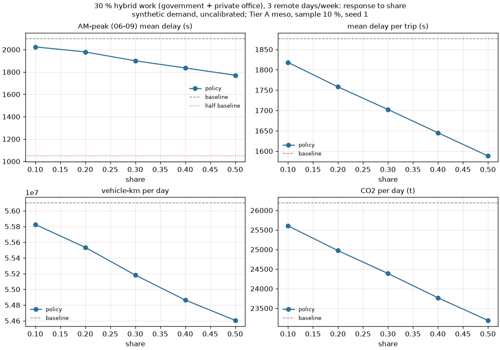

# Policy lab (M4)

All results: **synthetic demand, uncalibrated.** Tier A (SUMO mesoscopic), 10 % population sample
with capacity scaling (A-sim-101), seed 1. The city baselines are gridlock-affected in both peaks
(TA-011): every report shows the teleport share as a quality flag. Trust deltas more than levels.

## How a policy run works

```
uv run python -m sim.runner --policy remote_work_30 --daytype weekday --sample 0.10 --seed 1
```

1. **Baselines.** `--daytype` names the comparison baseline. A policy whose first transform is
   `daytype` (Friday, Ramadan) starts from that day type's baseline; otherwise the run starts from
   the comparison baseline. Baselines are looked up in `runs/` by day type, sample, seed, network
   hash and population hash (and run with `python -m sim.runner --baseline` if missing).
2. **Transforms** (`sim/policies/transforms.py`) edit the starting baseline's person trips and
   vehicle trips at the tour level: remove tours, re-time them, add tours, or change their mode.
   The plan is recomputed from the population and checked against the baseline's vehicles hash.
   Random draws use streams keyed by the seed and the transform type, so a sweep over a share
   selects nested sets of people and the response curve is monotone in the selection.
3. **Incremental routing** (TA-014, A-pol-090). Vehicles whose trip is unchanged (same id, type,
   departure, origin, destination) keep their baseline route. New, re-timed, re-moded and
   affected vehicles (closure, cordon) get a one-shot `duarouter` route on the starting baseline's
   congested travel times (its edgedata aggregated per 900 s, plus policy penalties). One-shot
   routing on fixed weights draws no random numbers, so it is repeatable with any thread count
   (tested). There is no re-equilibration: drivers do not move into capacity the policy frees,
   so deltas are first-order.
4. **Matched control** (TA-018). The baseline's 3-step assignment is far from equilibrium: a
   placebo run that re-routes 8 % of unchanged vehicles one-shot (no trip changed) cuts city mean
   delay by 20 % (`runs/placebo_reroute_8pct`). Any policy that re-routes baseline vehicles
   (re-timed school runs, cordon crossers, closure detours) would be credited with that routing
   gain. So when a policy re-routes vehicles that exist in the baseline, the runner also runs a
   control (`runs/<id>--control`): the baseline demand with exactly those vehicles re-routed at
   their baseline times on the same weights, no policy. The report compares the policy with the
   control and shows the raw-baseline comparison in a folded section. New trips (induced tours,
   deadhead legs) need no control.
5. **Simulation** with exactly the baseline's options (meso, limited junction control, 120 s
   teleport time, capacity scaling); a policy that changes nothing reproduces the baseline
   tripinfo bit for bit (test `test_null_policy_reproduces_the_baseline`). A daytype-only policy
   reuses the day type's baseline outputs (hard links).
6. **Report** `runs/<id>/policy_report.json` and `.md`: city KPIs vs the baseline (mean delay,
   AM-peak delay, speed, VKT, VHT, delay hours, throughput, peak hour, top-hour share, CO2, NOx,
   teleports), peak spreading (AM 06-09, PM 16-19, baseline peak hour, hourly table), per-district
   winners and losers (origin district, change in mean delay per trip, districts with >= 1,000
   trips), the ten most relieved and most worsened corridors (time loss per street name,
   city-equivalent vehicle-hours), the transform effects, the assumption ids used and provenance.

Run directories are `runs/<policy id>` (suffixes `-vs-<daytype>`, `-f<sample>`, `-s<seed>` when a
run differs from the policy's defaults). Policy outputs are gzipped (TA-016).

## Transforms

| type | parameters | what it does |
|---|---|---|
| `remote_work` | share (or per sector), days_per_week, eligible_sectors, induced_trip_probability, induced_purposes | a worker in an eligible sector is at home today with probability share x days/5; their work tour (and its vehicles) is removed; with the induced probability they make one daytime non-work tour timed like homemakers' tours |
| `staggered_hours` | segment (school, government, ...), offset_minutes, spread_minutes, share | a share of institutions (grouped by district of the school or workplace; no school ids in the population) shifts every leg of its members' main tours by the offset plus an institution-level N(0, spread); escort legs follow |
| `daytype` | daytype | the run starts from that day type's baseline (whole population re-timed) |
| `pt_line` | line_id, stops (lon/lat), both_directions, headway_s, hours, catchment_m, shift_share, shift_modes | stops snapped to bus-capable edges in the line's direction; `ptlines2flows.py` (on a sub-network around the line) builds bus flows and stops; a fixed share of car tours with both ends within the catchment of different stops switches to bus |
| `road_pricing` | polygon, charge_sar, hours, direction, elasticity, base_trip_cost_sar, retime_share, value_of_time_sar_h | tours whose baseline route crosses the cordon during the hours: suppressed share 1 - (1 + charge/cost)^elasticity, of which retime_share move just outside the hours and the rest are dropped; the remaining crossers are re-routed with charge/VOT seconds added to cordon-crossing edges |
| `network_change` | edits (edges or name + bbox; closed, lanes, speed_kmh), new_edges, tls_program | netconvert patch on the baseline network (variant `data/jeddah/<base>.<policy>-<hash>.net.xml.gz`); an empty patch reproduces the network body byte for byte; vehicles using removed edges are re-routed, trip ends on removed edges move to the nearest open edge of the zone |
| `ridehail_share` | convert_share, deadhead_factor | a share of car-driver tours becomes ride-hail; each new ride gets an empty leg from a zone about deadhead_factor x trip distance away |

## Demo policies

| file | policy | compared with |
|---|---|---|
| `remote_work_30.yaml` | 30 % hybrid work in government and private offices, 3 days/week, induced trips 0.35 | weekday |
| `staggered_schools_60.yaml` | schools in half of the districts start 60 min later | weekday |
| `friday.yaml` | Friday profile | weekday |
| `ramadan_weekday.yaml` | Ramadan-weekday profile | weekday |
| `bus_line_tahlia.yaml` | bus line on Tahlia Street, 10 stops, every 10 min, 10 % car shift in the catchment | weekday |
| `cordon_center.yaml` | SAR 10 cordon around central Jeddah, 07:00-19:00 | weekday |
| `close_corniche_road.yaml` | close 3 km of the North Corniche Road (both directions) | weekday |
| `ramadan_remote_30.yaml` | composed: Ramadan weekday + 30 % hybrid work | Ramadan weekday |
| `ridehail_plus_10.yaml` | P1: 10 % of car tours to ride-hail with deadhead 0.4 | weekday |

## Results (10 % sample, seed 1)

Changes vs the matching baseline, same seed (synthetic demand, uncalibrated).

| policy | vs baseline | mean delay | AM-peak delay | VKT | VHT | CO2 | top-hour share | trips | teleports/veh (base -> policy) |
|---|---|---|---|---|---|---|---|---|---|
| `remote_work_30` | weekday | -9.3 % | -9.4 % | -1.6 % | -7.7 % | -6.9 % | -1.0 % | -1.3 % | 0.51 -> 0.45 |
| `staggered_schools_60` | weekday (matched control) | -1.1 % | -9.1 % | +0.2 % | -0.7 % | -0.6 % | -19.1 % | +0.1 % | 0.48 -> 0.47 |
| `friday` | weekday | -14.9 % | -98.0 % | -3.3 % | -12.5 % | -13.0 % | -7.2 % | -2.5 % | 0.51 -> 0.60 |
| `ramadan_weekday` | weekday | -3.8 % | -33.1 % | +13.8 % | +12.5 % | +12.4 % | -2.2 % | +16.0 % | 0.51 -> 0.48 |
| `bus_line_tahlia` | weekday | +2.5 % | +0.7 % | -0.2 % | +1.9 % | +1.7 % | +0.1 % | -0.0 % | 0.51 -> 0.52 |
| `cordon_center` | weekday (matched control) | +20.1 % | +8.6 % | -0.4 % | +12.4 % | +10.4 % | +1.4 % | -1.3 % | 0.47 -> 0.64 |
| `close_corniche_road` | weekday (matched control) | +1.1 % | +0.7 % | -0.1 % | +0.7 % | +0.6 % | +0.0 % | -0.1 % | 0.51 -> 0.51 |
| `ramadan_remote_30` | ramadan_weekday | -9.8 % | -13.9 % | -1.2 % | -7.9 % | -7.2 % | -2.0 % | -1.1 % | 0.48 -> 0.43 |
| `ridehail_plus_10` | weekday | +1.5 % | -0.5 % | +2.7 % | +5.2 % | +4.7 % | -2.1 % | +4.5 % | 0.51 -> 0.52 |

Reading the table (deltas in % of the matching baseline; the run-to-run noise is about +/-2 % on
delay and VHT, see below):

- **Remote work 30 %** removes 7,370 work tours in the sample (18 % of eligible workers at home
  today) and adds 2,635 induced tours: VKT -1.6 %, delay -9 %, CO2 -7 %. Delay falls far more than
  VKT because the network is gridlocked in the peaks (non-linear response).
- **Staggered schools** spreads the morning peak (top-hour share -19 %) and cuts AM-peak delay
  by 9 % against its matched control; the daily effect (-1 %) is within noise. Compared with the
  raw baseline it would have shown -21 % AM-peak delay, most of it the routing gain.
- **Friday** has almost no morning peak (-98 % AM-peak delay); the peak hour moves to 11:00
  (Jumu'ah travel); fewer trips and VKT, but more teleports per vehicle (midday gridlock).
- **Ramadan weekday**: 16 % more vehicle trips (late-night activity and iftar visits) and +14 %
  VKT, yet a flatter morning (AM-peak delay -33 %) and slightly lower mean delay.
- **Bus line on Tahlia** shifts only 11 tours in the 10 % sample (both ends within 500 m of
  different stops). Its +2.5 % delay is slightly above the one measured replicate (+1.8 %); with a
  single replicate it cannot be separated from noise (more replicates needed). A corridor line moves little city-wide traffic
  under a fixed 10 % shift; the buses themselves load the road (A-pol-091).
- **Cordon** (matched control): +20 % delay, +12 % VHT. Suppression is small (9.6 % of 33,718
  charged tours) while the 15-min penalty re-routes ~42,700 crossers onto perimeter roads that are
  already gridlocked. Indicative only: no destination or mode choice, one charge level.
- **Corniche closure**: 412 vehicles needed a new route; 287 were re-routed and 125 were
  unroutable (trip ends cut off by the closure); city-wide effect within noise (+1 % delay), local detours in the corridor tables.
- **Ramadan + 30 % remote** (vs the Ramadan baseline): -10 % delay, -14 % AM-peak delay, close to
  the weekday remote-work effect.
- **Ride-hail +10 %** (P1): converted tours keep their routes; the 17,729 empty legs add 2.7 %
  VKT and 5 % VHT, CO2 +5 %.

### Re-evaluation on network v2 (integration pass 6, 2026-10-17)

All rows: **synthetic demand, uncalibrated**.
Same policies, same seed 1 and 10 % sample, on the Tier A network v2 (`docs/network-v2.md`, hash
ae764558; zones d949c812, population 346893f2) against the v2 weekday baseline
`baseline-weekday-f0.1-s1-ae764558-346893f2-a998e1` (28.3 % teleports per vehicle vs 50.5 % on m2).
v1 rows are the m2 runs above, repeated with the absolute VHT change. Runs in `runs/v2/<policy>`
(`uv run python -m scripts.pass6_v2 run <job>`; rows from `scripts.pass6_v2 summary`). **Teleports**
are a quality flag: 27-30 % of vehicles still teleport on v2, so every v2 number is measured on a
network that is still gridlocked in the peaks. **Noise:** the v1 seed-noise band is about ±34k
VHT/day; no second-seed v2 baseline exists, so the v2 band is not measured.

| policy | network | vs | mean delay | AM-peak delay | VKT | VHT (abs) | CO2 | top-hour share | trips | teleports/veh (base -> policy) |
|---|---|---|---|---|---|---|---|---|---|---|
| `staggered_schools_60` | v1 (m2) | weekday (matched control) | -1.1 % | -9.1 % | +0.2 % | -0.7 % (-19,342 h) | -0.6 % | -19.1 % | +0.1 % | 0.478 -> 0.474 |
| `staggered_schools_60` | **v2** | weekday (matched control) | +2.1 % | -1.8 % | -0.1 % | +1.2 % (+23,033 h) | +1.1 % | -13.3 % | -0.0 % | 0.274 -> 0.275 |
| `remote_work_30` | v1 (m2) | weekday | -9.3 % | -9.4 % | -1.6 % | -7.7 % (-210,563 h) | -6.9 % | -1.0 % | -1.3 % | 0.505 -> 0.453 |
| `remote_work_30` | **v2** | weekday | -11.4 % | -13.2 % | -1.8 % | -8.7 % (-167,819 h) | -7.4 % | -0.9 % | -1.4 % | 0.283 -> 0.244 |
| `cordon_center` | v1 (m2) | weekday (matched control) | +20.1 % | +8.6 % | -0.4 % | +12.4 % (+309,345 h) | +10.4 % | +1.4 % | -1.3 % | 0.467 -> 0.643 |
| `cordon_center` | **v2** | weekday (matched control) | +29.7 % | +13.1 % | -0.6 % | +17.2 % (+341,271 h) | +14.1 % | +1.6 % | -1.4 % | 0.275 -> 0.454 |
| `obhur_bridge_b3` (B1 + B2, 2+2) | **v2** | weekday (matched control) | -12.1 % | -20.9 % | -4.1 % | -9.2 % (-178,909 h) | -8.1 % | -0.2 % | +0.2 % | 0.296 -> 0.305 |
| `obhur_bridge_b1` (mouth, 2+2) | **v2** | weekday (matched control) | -11.5 % | -18.6 % | -4.1 % | -8.8 % (-170,801 h) | -7.7 % | -0.2 % | +0.2 % | 0.296 -> 0.303 |

Controls on v2 (each re-routes the policy's vehicles at their baseline times without the policy;
compared with the raw v2 baseline): `staggered_schools_60--control` mean delay -3.5 %, VHT -2.0 %
(-38,818 h), teleports 0.283 -> 0.274; `obhur_bridge_b3--control` mean delay -1.9 %, VHT +0.5 %
(+9,794 h), teleports 0.283 -> 0.296 (`docs/obhur-bridge.md` §5); `cordon_center--control` mean
delay +1.8 %, VHT +2.0 % (+38,526 h), teleports 0.283 -> 0.275.

Reading the v2 rows:
- **Staggered schools** still flattens the morning (top-hour share -13 % vs -19 % on v1), but with
  the extra v2 capacity the AM-peak delay gain shrinks from -9.1 % to -1.8 %, and the daily VHT
  change (+23k h) is inside the v1 noise band: on a less overloaded network, spreading the school
  peak buys much less.
- **Remote work 30 %** removes the same share of work tours (7,318 in the sample, 2,596 induced
  tours added) and still cuts delay by 11 % (AM peak -13 %); in VHT it saves 167,819 h/day (-8.7 %)
  against 210,563 h on v1, because the v2 baseline has fewer vehicle-hours to save (1.94 M vs 2.74 M).
  Far outside the v1 noise band; its ranking as the strongest demand lever holds on v2.
- **Cordon** (SAR 10, 07-19 h): the same mechanism as on v1 (9.6 % of 33,500 charged tours
  suppressed; 42,460 crossers re-routed with the 15-min penalty onto the perimeter) makes things
  worse on v2 too: +30 % delay, +341,271 VHT/day. **Teleports rise from 0.275 to 0.454 per vehicle**
  (+65 %), so a large part of this run is gridlock on the perimeter roads; read the size as
  indicative and the sign as robust (no destination or mode choice, one charge level).
- **Obhur bridges** (Track J; no v1 city run exists, v1 = window scale only): both cut city VHT by
  about 9 % against their matched control, almost all from B1 at the creek mouth; detail, saturation
  and district flags in `docs/obhur-bridge.md` §5. Loop C1 on v2: `docs/loop.md`.

Per-policy detail (districts, corridors, hourly profile): `runs/<policy>/policy_report.md`.

## Response curve: remote-work share

```
uv run python -m sim.policies.sweep --policy remote_work --param share=0.1:0.5:0.1 --sample 0.10
```
`runs/sweep-remote_work_30-share/response_curve.csv` and `.png` (5 points, 2 parallel processes,
33 min wall). The share is the hybrid share of eligible (government, private-office) workers at
3 remote days a week, induced trips 0.35.

| hybrid share | workers at home today | mean delay | AM-peak delay | VKT | CO2 |
|---|---|---|---|---|---|
| 0.1 | 6 % | -3.1 % | -3.5 % | -0.5 % | -2.2 % |
| 0.2 | 12 % | -6.3 % | -5.7 % | -1.0 % | -4.6 % |
| 0.3 | 18 % | -9.3 % | -9.4 % | -1.6 % | -6.9 % |
| 0.4 | 24 % | -12.3 % | -12.5 % | -2.2 % | -9.2 % |
| 0.5 | 30 % | -15.4 % | -15.6 % | -2.7 % | -11.4 % |



The response is close to linear (about -3 % delay per 0.1 of share). **No share in the tested
range halves the morning peak**: at 0.5 the AM-peak delay falls by 16 %; a straight-line
extrapolation would need a share far above 1, i.e. remote work for desk workers alone cannot halve
the morning peak in this model (the school peak is untouched; see staggered schools). The
0.3 point reproduces the `remote_work_30` run exactly (same transform, same seed: determinism).

## Noise and bias checks

| run | vs | mean delay | AM-peak delay | VKT | VHT | CO2 | top-hour share | trips | teleports/veh |
|---|---|---|---|---|---|---|---|---|---|
| noise replicate (sim seed 2) | weekday | +1.8 % | +1.3 % | +0.0 % | +1.3 % | +1.1 % | +0.0 % | +0.0 % | 0.51 -> 0.51 |
| placebo: 8 % re-routed | weekday | -20.1 % | -12.6 % | +2.0 % | -13.3 % | -11.5 % | -0.2 % | +0.3 % | 0.51 -> 0.38 |
| control of staggered_schools_60 | weekday | -4.7 % | -12.8 % | +0.3 % | -3.0 % | -2.6 % | +0.1 % | +0.0 % | 0.51 -> 0.48 |
| control of cordon_center | weekday | -13.7 % | -11.2 % | +1.9 % | -8.7 % | -7.6 % | -0.2 % | +0.3 % | 0.51 -> 0.47 |
| control of close_corniche_road | weekday | -0.1 % | +0.1 % | +0.1 % | +0.1 % | +0.1 % | +0.0 % | +0.0 % | 0.51 -> 0.51 |

- **Run-to-run noise**: the weekday baseline re-simulated with simulation seed 2 (same routes).
  Policy deltas smaller than this are not distinguishable from noise.
- **Routing gain**: the placebo re-routes 8 % of baseline vehicles one-shot without changing any
  trip. Its large "improvement" is why policies that re-route baseline vehicles are compared with
  a matched control (TA-018).

## Limitations

- One-shot routing, no re-equilibration (A-pol-090); deltas are first-order.
- Meso gridlock makes delay strongly non-linear in demand: removing ~2 % of vehicle trips can cut
  mean delay by ~10 %. Delay changes overstate what a less congested (better-calibrated) network
  would show; VKT and trip counts are more robust.
- One seed; no confidence intervals yet.
- Bus vehicles are not capacity-scaled (A-pol-091); no bus passenger KPIs (no person-level PT
  simulation in v1).
- Road pricing is indicative (PROJECT.md section 7): constant elasticity, no destination choice.
- The baseline assignment (3 duaIterate steps) is far from user equilibrium (placebo above);
  absolute delays and the size of any re-routing effect depend on it. More assignment steps are
  the fix once compute allows (each step ~30-45 min at 10 %).
- All three city baselines (weekday from M2, Friday, Ramadan) were assigned with 8 routing threads
  (TA-015): reproducible from the route cache, not from the seed alone; policy runs on them are
  deterministic given those routes.
