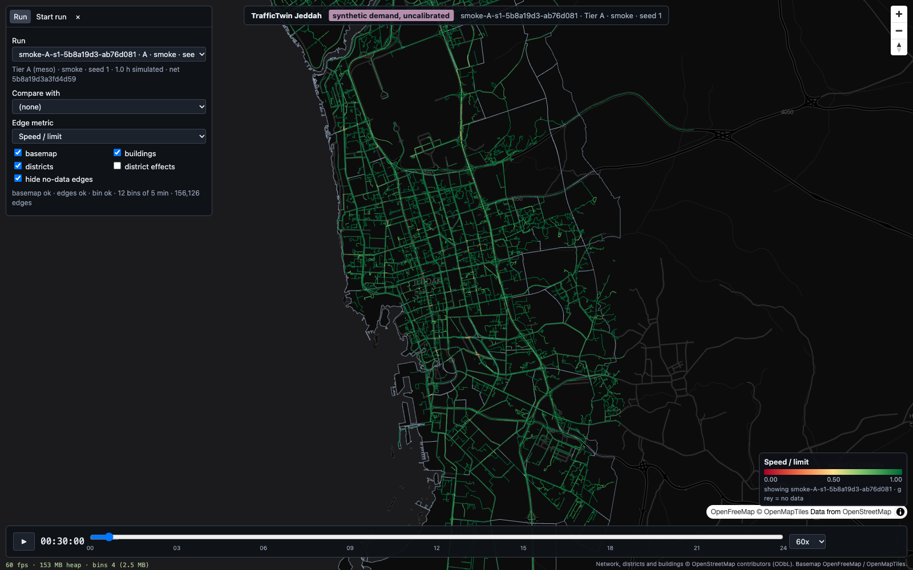

# Viewer (M3)

React 19 + TypeScript (strict) + Vite + deck.gl 9.4 over MapLibre 5, in `web/`. It reads everything
from the file-backed API (`api/`, contract: [`docs/contracts/run-outputs.md`](contracts/run-outputs.md)).
The browser only sees lon/lat. Every screen shows the label **synthetic demand, uncalibrated**.



## Run it

```bash
# 1. API (port 8000)
uv run uvicorn api.main:app --port 8000
# optional: fictional example reports for the demo window run
uv run python -m api.examples smoke-B-s1-25c06763-9cfa755f

# 2. Viewer (port 5173); local npm has omit=dev, so include dev deps explicitly
cd web && npm install --include=dev && npm run dev      # http://localhost:5173
```

Docker: `docker compose up --build` starts `api` and `web` (`npm ci && npm run dev -- --host 0.0.0.0`).
The Vite proxy sends `/api` and `/health` to `VITE_API_TARGET` if set, otherwise to
`http://api:8000` when `/.dockerenv` exists (inside the container), otherwise to `http://localhost:8000`.

Other scripts: `npm run typecheck`, `npm run build` (typecheck + bundle to `web/dist/`),
`npm run screenshot` (writes `docs/img/m3-*.png`) and `npm run perf` (frame rate and memory, JSON on
stdout). Both scripts need the API and the dev server running; set `TT_WEB_URL` if the dev server is
not on `http://localhost:5173`.

## Features and controls

| area | what it does |
|---|---|
| Banner (top centre) | label "synthetic demand, uncalibrated", run id, tier, kind, seed; always visible |
| Run tab | run picker (`GET /api/runs`: id, tier, kind, seed), comparison run (same `network_hash` only; default `meta.baseline_run_id`), **show scenario / show baseline / difference**, edge metric (`speed_rel`, `speed_kmh`, `delay_s_per_veh`, `density_veh_km`, `flow_veh_h`), vehicle colouring (speed or vehicle type; Tier B), toggles: basemap, buildings, districts, district effects (choropleth), hide no-data edges; load status line |
| Edges (Tier A and B) | `PathLayer` with binary attributes from `edges.bin`; colours rebuilt per 5-minute bin; width from lane count (metres, clamped in pixels); hover shows name, edge id, type, lanes, limit and the current value (or "no data") |
| Difference mode | scenario bin minus comparison bin, computed in the browser; diverging RdBu scale where blue is always "better" (faster, less delay) |
| Tier B | `TripsLayer` from `/trajectories` (binary attributes, 30 s trail), coloured by speed (magenta slow to cyan/white fast, distinct from the edge palette) or by vehicle type; Tier B edge bins underneath, dimmed |
| Buildings | `GeoJsonLayer` extruded by `height_m` from `/api/geo/buildings?bbox=` (bbox of the run's network); drawn in Tier B and in Tier A from zoom 13 |
| Districts | outlines from `/api/geo/districts`; choropleth from `/district-effects?baseline=` (diverging scale, legend, value on hover; range = 90th percentile of the absolute values, so an outlier district does not wash out the rest; the legend says when it clips) |
| Events and closures | from `/scenario-report`: event marker + type label + highlighted event edges (yellow), closures as red dashes; drawn only while the playhead is inside `[begin_s, end_s]` |
| Timeline (bottom) | 0-24 h slider (HH:MM:SS readout), play/pause, speed 1x/10x/60x/300x/900x simulated seconds per second; the run's data span is shaded; outside it edges show "no data"; playback loops inside the data span |
| Reports tab | policy report summary and scenario summary tables (tab hidden when both are 404) |
| Strategist tab | ranked options (rank, title, action class, score, explanation, effects), operator and note fields, **Approve / Reject** -> `POST .../decision`; decision log with time, option, decision, operator and hash prefix (prev hash on hover). Tab hidden when `/recommendations` is 404. Approving only logs; nothing is actuated |
| Start run tab | Tier and seed -> `POST /api/jobs` (`kind: smoke`), live log from the SSE stream `/api/jobs/{id}/events`, refreshes the run list and selects the new run on `done` |
| HUD (bottom left) | fps (rAF), JS heap (`performance.memory`, Chrome only), bin cache entries and MB |

Mouse: drag to pan, right-drag or ctrl-drag to rotate/pitch, scroll to zoom.

### URL parameters (deep links)

| param | values | default |
|---|---|---|
| `run` | run id | first Tier A run |
| `compare` | run id on the same network | `meta.baseline_run_id` |
| `mode` | `scenario`, `baseline`, `diff` | `scenario` |
| `metric` | `speed_rel`, `speed_kmh`, `delay_s_per_veh`, `density_veh_km`, `flow_veh_h` | `speed_rel` |
| `t` | `HH:MM`, `HH:MM:SS` or seconds | start of the run's data |
| `play` | `1` | paused |
| `speed` | `1`, `10`, `60`, `300`, `900` | `60` |
| `panel` | `run`, `reports`, `strategist`, `jobs`, `none` | `run` |
| `view` | `lon,lat,zoom[,pitch[,bearing]]` | fit to the network (Tier B pitched 55 degrees) |
| `basemap`, `buildings`, `districts` | `0` to hide | shown |
| `choropleth`, `hidenodata` | `1` to enable | off |
| `color` | `vtype` | `speed` |

The URL is rewritten with `history.replaceState` when the state changes, on pause, after a seek and
after camera moves (never per frame), so the address bar is always a shareable link. Example:
`/?run=smoke-A-s1-5b8a19d3-ab76d081&compare=smoke-A-s1-5b8a19d3-6ba142f4&mode=diff&metric=speed_kmh&t=00:45&play=1&speed=300`.

## Data flow

1. `GET /api/runs` -> run list. Selecting a run loads, in parallel: `edges.bin` (once per network hash,
   cached for the session), `edges.json` (names and lanes, used for tooltips, widths and event edge
   lookup), `/bins` (bin width, span, colour stats), buildings for the network bbox, and the optional
   reports (404 = hidden). Tier B also loads `/trajectories?begin=0&end=<sim_seconds>&step=1`.
2. `src/engine.ts` (plain TypeScript, not React) owns MapLibre, the deck.gl `MapboxOverlay`
   (overlaid mode) and the clock. Its rAF loop advances `t`, works out the bin index, and when the
   (run, metric, mode, bin) key changes it takes the bin(s) from the LRU cache and refills one
   preallocated `Uint8Array` RGBA buffer (one colour per path vertex) through 256-entry colour lookup
   tables. The `PathLayer`'s `data` object stays the same; only `data.attributes.getColor` gets a new
   wrapper and `updateTriggers.getColor` is bumped, so deck re-uploads colours without
   re-tessellating the 435k-vertex geometry.
3. `src/binCache.ts`: LRU of 24 bins per (run, metric), in-flight de-duplication, prefetch of the next
   3 bins (and the comparison run's in diff mode). A bin that is not cached yet keeps the previous
   colours until it arrives (no flicker).
4. New layer instances go to deck only when something visible changed; every frame only while trips
   are animating (`TripsLayer.currentTime`). React state is not touched per frame: the timeline
   readout is written to the DOM by an engine listener at about 10 Hz, and the HUD has its own rAF
   counter.

### Data contract as used by the viewer (measured on the M2 smoke runs)

| endpoint | format | size |
|---|---|---|
| `GET /api/networks/{hash}/edges.bin` | `TTE1` header + uint32 `startIndices[n+1]` + float32 lon/lat | city: 156,126 edges, 434,982 points = 4.10 MB raw, 2.07 MB gzip; once per session |
| `GET /api/networks/{hash}/edges.json` | ids, names, types, lanes, speed_kmh in index order | city: 7.27 MB raw, 0.43 MB gzip; once per session |
| `GET /api/runs/{id}/bins/{i}?metric=` | float32 LE `[n_edges]`, NaN = no data | city: 624,504 B per bin per metric = **7.5 MB per simulated hour per metric raw**; on the wire 44 KB per bin (gzip; mostly NaN at smoke demand, more at peak) |
| `GET /api/runs/{id}/trajectories` | TripsLayer JSON (`path`, `timestamps`, `speeds`) | demo window, 1 h, 1,800 vehicles, 273k points at 1 s: 9.5 MB raw, 2.3 MB gzip |
| `GET /api/geo/buildings?bbox=` | GeoJSON with `height_m` | whole city: 8.9 MB raw, 1.3 MB gzip |
| `GET /api/geo/districts` | GeoJSON, 112 districts | 0.36 MB raw, 0.09 MB gzip |

Tier A never ships vehicles; only per-edge aggregates.

## Performance

Method: `npm run perf` (`web/scripts/perf.mjs`) with puppeteer-core driving the installed Google
Chrome in headless mode with hardware WebGL. Flags: `--headless=new --use-angle=metal --enable-gpu
--ignore-gpu-blocklist --enable-webgl` (plus `--enable-precise-memory-info --js-flags=--expose-gc`).
The page reports WebGL renderer **"ANGLE (Apple, ANGLE Metal Renderer: Apple M3 Pro)"**, so this is the
GPU, not SwiftShader. Viewport 1600x1000 at device pixel ratio 1. Each scenario gets a fresh
browser, waits until all data is loaded and drawn, then plays for 20 s while a `requestAnimationFrame`
loop records frame intervals and the JS heap. "Orbit" scenarios also rotate the camera every frame,
so every frame is a full redraw of the whole network (a static camera lets deck skip redraws between
bins). Chrome memory is the RSS of the whole process tree (`ps`). Measured 2026-10-16:

| scenario (20 s) | median fps | p5 fps | frames > 33 ms | uncapped median / p5 fps | JS heap max | Chrome RSS total (renderer / GPU) | recolour per bin |
|---|---|---|---|---|---|---|---|
| Tier A full city, 300x, static camera | 59.9 | 59.9 | 0 | (see note) | 138 MB | 863 MB (340 / 113) | 2.9 ms mean, 6.1 ms max |
| Tier A full city, 300x, orbiting camera | 59.9 | 59.5 | 0 | 172 / 114 | 146 MB | 953 MB (403 / 131) | 2.7 ms mean |
| Tier A difference (2 city runs), 300x, orbiting | 59.9 | 59.9 | 0 | 172 / 115 | 154 MB | 971 MB (416 / 133) | 2.4 ms mean |
| Tier B trips (1,800 veh) + buildings, 60x, orbiting | 59.9 | 59.5 | 1 (50 ms, once) | 133 / 102 | 135 MB | 995 MB (463 / 133) | 0.05 ms |

- Chrome RSS varies from run to run: an independent re-run by the verifier (10 s per scenario, same
  flags, same day) measured 1,102-1,388 MB total RSS for the same four scenarios (JS heap 131-150 MB,
  59.9 fps median, p5 59.5-59.9). Treat browser memory as **0.86-1.39 GB**, still under 2 GB.
- Budget (60 fps on the M3 Pro with the full network, under 2 GB browser memory): **met**. Default
  runs are vsync-capped at 60 fps. The uncapped column (`TT_PERF_UNCAPPED=1`, adds
  `--disable-gpu-vsync --disable-frame-rate-limit`) shows the headroom: about 2.9x for the full city
  with a moving camera. With a static camera and no vsync, headless rAF stops being driven by redraws
  (56 fps median); that number does not measure rendering, so it is left out.
- At 300x, a new bin arrives every second; the recolour (156k edges, 435k vertices) takes about 3 ms
  and the colour upload does not show up as a frame-time spike.
- The bin cache holds 12 bins (7.5 MB) for the 1 h city run, 24 in diff mode (15 MB).
- **Headless caveat:** frame pacing in headless Chrome is close to, but not the same as, a visible
  window on the built-in display (ProMotion can go to 120 Hz; compositing of a real window adds
  some cost). RSS includes Chrome's own browser and utility processes, not only the page. Numbers are for a 1 h smoke run; a 24 h run changes the bin count, not the per-frame cost
  (12 bins per hour, 24 cached per run and metric).

## Screenshots

`npm run screenshot` writes these (same Chrome flags; it waits until the viewer reports ready):

| file | content |
|---|---|
| `img/m3-tierA.png` | city run `smoke-A-s1-5b8a19d3-ab76d081`, speed/limit at 00:30, no-data edges hidden |
| `img/m3-tierA-diff.png` | difference mode, speed (km/h), city run minus the second city run `smoke-A-s1-5b8a19d3-6ba142f4` at 00:45 |
| `img/m3-tierB.png` | demo window `smoke-B-s1-25c06763-9cfa755f`, pitched 3D camera, extruded buildings, vehicle trails over the Tier B edge bins |
| `img/m3-events.png` | Tier B at 00:40 with the fictional example accident (marker, label, highlighted edge) and closure (red dashes), Reports tab open |
| `img/m3-strategist.png` | Strategist tab: three ranked fictional options, approve/reject, decision log with hash prefix |
| `img/m3-choropleth.png` | district choropleth of `mean_speed_delta_pct` (computed from edge bins) for the two city runs |

The example reports for the demo run are fictional (`uv run python -m api.examples ...`).

## Known limits

- Tier B loads the whole trajectory span in one request (fine for the demo window: 9.5 MB for 1 h).
  Long or large Tier B windows will need time-windowed chunks (`begin`/`end` are already in the API).
- Trajectory positions are kept as float64 in the browser; edge geometry is float32 (about 0.4 m
  resolution at Jeddah's longitude), which is enough for drawing.
- The colour range for delay, density and flow is `[0, p95]` of the run (from `/bins` stats), so it
  changes between runs; speed metrics use fixed ranges. Difference ranges are fixed per metric
  (`src/config.ts`).
- Playback loops inside the run's data span; outside it the slider still moves over 0-24 h and edges
  show "no data".
- Not exercised end to end from the browser in this milestone: starting a job (it writes a new run
  directory) and posting a decision (it appends to `decisions.jsonl`). The decision log was checked
  rendering an existing entry; SSE is not gzip-buffered (Starlette excludes `text/event-stream`).
- `docker compose` was not re-run for this milestone because the Docker daemon was not running; a
  clean `npm ci --include=dev && npm run build` on a copy of `web/` passes, and the proxy chooses
  `http://api:8000` when `/.dockerenv` exists.
- No fast refresh in dev (React runs through esbuild's automatic JSX, without `@vitejs/plugin-react`,
  whose current version needs Vite 8). Reload the page after editing.
- The bundle is one 2.2 MB chunk (626 KB gzip), mostly deck.gl and MapLibre.
- The OpenFreeMap style references a few sprite images it does not ship (console warnings such as
  "wood-pattern"); harmless. If the style cannot be fetched within 6 s, a plain dark background is used.
